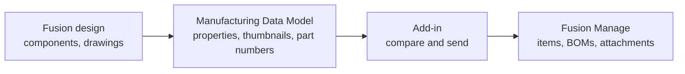

# Overview

The add-in connects the design you have open in Fusion to your Fusion Manage tenant. It reads the design's components, properties and thumbnails from the Manufacturing Data Model, compares them with what already exists in Fusion Manage, and sends only what needs to be created or changed.

## What it does

| Capability | Where to read more |
|---|---|
| Sign in to Fusion Manage from Fusion using your Autodesk account | [Installation and Authentication](03-installation-and-authentication.md) |
| Map Manufacturing Data Model properties to Fusion Manage fields | [Manufacturing Data Model](04-manufacturing-data-model.md) |
| Create and update items in a Fusion Manage workspace | [Publishing Enterprise Items](05-publishing-enterprise-items.md) |
| Compare and synchronise the design BOM with the Fusion Manage BOM | [BOM Synchronisation](06-bom-synchronisation.md) |
| Attach a STEP file of a component, or a PDF of a drawing, to an item | [Technical Representation](07-technical-representation.md) |
| Browse an item's fields, files, BOM, where-used and workflows inside Fusion | [Item Review & Release](08-item-review-and-release.md) |

To see how these fit together in practice, from engineering release through to release in Fusion Manage, read the [End-to-End Workflow](02-end-to-end-workflow.md).

## How it fits together

Items are matched by **item number**, which the add-in takes from the component's part number. If an item with that number already exists in Fusion Manage it is updated; otherwise it is created.

## The user interface

The add-in adds a **Fusion Manage** tab to the ribbon in the **Design** and **Drawing** workspaces.

| Panel | Button | Purpose |
|---|---|---|
| Item | Open Fusion Manage Item | Show the Fusion Manage item of the selected component, or of the open design or drawing. |
| Item | Publish Fusion Manage Item (Design only) | Preview and publish the open design. |
| Item | Upload Drawing Representation To Fusion Manage Item (Drawing only) | Attach a PDF of the open drawing. |
| Administration | Job Queue | See publishes that are waiting, running and finished. |
| Administration | Preferences | Sign in, set the connection and the workspace mapping. |

Most buttons stay greyed out until the Items workspace is configured (see [Manufacturing Data Model](04-manufacturing-data-model.md)). The tooltip of a greyed-out button says why.

The same actions are available from the right-click menu of a component in the browser or canvas: **Open Fusion Manage Item**, **Publish Fusion Manage Item** (top-level component only), **Upload STEP File To Fusion Manage Item** and, in a drawing, **Upload Drawing Representation To Fusion Manage Item**.

## Requirements

- Autodesk Fusion on Windows or macOS.
- A Fusion Manage tenant and a user with permission to work in the target workspace.
- An Autodesk Platform Services (APS) application registered for sign-in (see [Installation and Authentication](03-installation-and-authentication.md)).

## Scope of this release

This is version 0.1.0. It works with a single Fusion Manage workspace, **Items**. See [Troubleshooting and Limitations](09-troubleshooting-and-limitations.md) for what is not yet supported.
