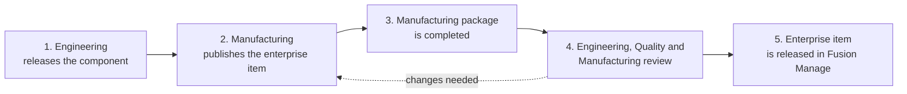

# End-to-End Workflow

This page follows one component from the engineer's release in Fusion to its release as an enterprise item in Fusion Manage. It shows who does what at each stage, which part the add-in handles, and which parts happen elsewhere.

| Stage | Who | Where | Add-in role |
|---|---|---|---|
| [1. Engineering releases the component](#1-engineering-releases-the-component) | Engineering (designers) | Fusion | Reads the result from the Manufacturing Data Model |
| [2. Manufacturing publishes the enterprise item](#2-manufacturing-publishes-the-enterprise-item) | Manufacturing | Fusion | **Publishes** the item and its BOM |
| [3. Complete the manufacturing package](#3-complete-the-manufacturing-package) | Manufacturing | Fusion and Fusion Manage | **Attaches** STEP and drawing PDF; **adds** BOM lines |
| [4. Review](#4-engineering-quality-and-manufacturing-review) | Engineering, Quality, Manufacturing | Fusion or Fusion Manage | **Shows** the item in the Item panel |
| [5. Release the enterprise item](#5-the-enterprise-item-is-released-in-fusion-manage) | Release approvers | Fusion Manage | None. Release is a Fusion Manage workflow |

!!! note "What the add-in does not do"
    The add-in does not enforce this process. It will publish any design you open, whatever its state, and it does not release items or start workflows. The sequence below is the recommended way to use it, and your organisation's own release rules still apply.

## Before you start

One-time setup, done once per user (or once and shared by export):

- The add-in is installed and you are signed in ([Installation and Authentication](03-installation-and-authentication.md)).
- The Items workspace is configured, with field mappings and a match key ([Manufacturing Data Model](04-manufacturing-data-model.md)).
- Every user who publishes holds the Fusion Manage permissions listed in [Installation and Authentication](03-installation-and-authentication.md#permissions-in-fusion-manage).

## 1. Engineering releases the component

**Who:** Engineering, meaning the designers who do the CAD work. **Where:** Fusion.

Engineers model the component and create its drawing in Fusion, then release both. The add-in is not involved in this step. What matters for the next stage is that the design and its drawing are saved and released, and that each component that should become an item has a **part number**.

The drawing is not published as an item of its own. It is attached later, as a PDF, to the item of the design it shows (see [stage 3](#3-complete-the-manufacturing-package)). The drawing therefore has to reference the released design, and that design's top-level component needs a part number.

The part number is the **item number** in Fusion Manage. It is how the add-in decides whether to create an item or update an existing one, so check it before handing over.

The add-in can carry the release outcome into Fusion Manage. If you map the **Revision** and **Lifecycle state** sources to Fusion Manage fields, the values set by Engineering are published with the item. See [Manufacturing Data Model](04-manufacturing-data-model.md#available-sources).

**Hand-over checklist**

- [ ] The design and its drawing are saved and released.
- [ ] The Manufacturing Data Model has finished processing the design.
- [ ] The top-level component and every component to publish have part numbers.
- [ ] The drawing references the released design.
- [ ] Properties that are mapped to Fusion Manage fields (material, description, custom properties) are filled in.

## 2. Manufacturing publishes the enterprise item

**Who:** Manufacturing. **Where:** Fusion. **Add-in:** Publish Fusion Manage Item.

1. Open the released design.
2. Choose **Fusion Manage ▸ Item ▸ Publish Fusion Manage Item**.
3. Review the BOM and each component's properties in the Details Panel. Anything marked **New** or **Update** will change in Fusion Manage.
4. Click **Publish**.

The add-in creates an item for each component that does not have one, updates the ones that do, and then synchronises the BOMs. Fusion Manage lines that the design does not have are kept unless you choose to remove them. Progress is shown in the **Job Queue**, and a summary appears when the run ends.

For the full procedure, see [Publishing Enterprise Items](05-publishing-enterprise-items.md) and [BOM Synchronisation](06-bom-synchronisation.md).

**Outcome:** every component exists as an item in the Items workspace, with its properties, thumbnail and BOM.

## 3. Complete the manufacturing package

**Who:** Manufacturing. **Where:** Fusion and Fusion Manage.

The published item is the foundation. Manufacturing now adds what is needed to make it.

| Task | How |
|---|---|
| Attach a STEP file of a component | Select the component and choose **Upload STEP File To Fusion Manage Item** ([Technical Representation](07-technical-representation.md)). |
| Attach a PDF of the drawing | Open the drawing and choose **Upload Drawing Representation To Fusion Manage Item**. |
| Add items that are not in the design | Use **Add Items** in the Publish panel, then publish again ([BOM Synchronisation](06-bom-synchronisation.md#add-items)). |
| Keep or change manufacturing lines that only Fusion Manage has | Review the **Fusion Manage Only** lines. They are kept unless you remove them. |
| Complete fields that the design does not supply | Edit these in Fusion Manage. Fields that are not mapped are never overwritten by a publish. |

Uploading a file that is already attached creates a **new version** of it rather than a duplicate, so the package can be refreshed as the design changes.

!!! tip "Design changes during this stage"
    If the design changes, publish again. Items that already match are left alone and only differences are sent, so repeating a publish is safe.

**Outcome:** each item carries its STEP file, its drawing PDF and a complete BOM.

## 4. Engineering, Quality and Manufacturing review

**Who:** Engineering, Quality and Manufacturing. **Where:** Fusion, or Fusion Manage in a browser.

Each group checks the item against the design. In Fusion, open the **Item panel** (**Open Fusion Manage Item**) on the component. Anyone without the add-in, or who prefers the web, can review the same item in Fusion Manage directly.

| Review | Look at |
|---|---|
| Engineering: does the item match the design and drawing? | **Item** tab fields against the design's properties; **Bill of Materials** tab against the design BOM. |
| Quality: is the documentation present? | **Files** tab for the STEP file and drawing PDF. **Item** tab for revision and lifecycle state. |
| Manufacturing: is the package complete? | **Bill of Materials** tab, including the manufacturing lines; **Where Used** for the assemblies that hold the item. |
| Everyone: is anything already in flight? | **Associated Workflows** tab for change orders that reference the item and their current state. |

See [Item Review & Release](08-item-review-and-release.md) for what each tab shows.

If the review finds a problem, correct it at the source: change the design in Fusion and publish again, or change the data in Fusion Manage. Then repeat the review.

**Outcome:** the item is agreed to be correct and complete.

## 5. The enterprise item is released in Fusion Manage

**Who:** Release approvers. **Where:** Fusion Manage.

Release is a workflow in Fusion Manage and is done there. The add-in does not move an item through its workflow.

1. In the Item panel, click **Open in browser** to go straight to the item.
2. In Fusion Manage, run the workflow action your organisation uses to release the item, for example by creating or advancing the relevant workflow item.
3. Back in Fusion, click **Refresh** in the Item panel to see the new state, or check the **Associated Workflows** tab for the workflow's progress.

**Outcome:** the item is released and available to the rest of the business.

## Quick reference

| I want to… | Use |
|---|---|
| Create or update items from a design | **Publish Fusion Manage Item** |
| See whether a publish succeeded | **Job Queue** |
| Retry after a failure | **Send to Fusion Manage** in the Job Queue |
| Attach a STEP file | **Upload STEP File To Fusion Manage Item** |
| Attach a drawing PDF | **Upload Drawing Representation To Fusion Manage Item** |
| Review an item | **Open Fusion Manage Item** |
| Release an item | Fusion Manage, via **Open in browser** |
