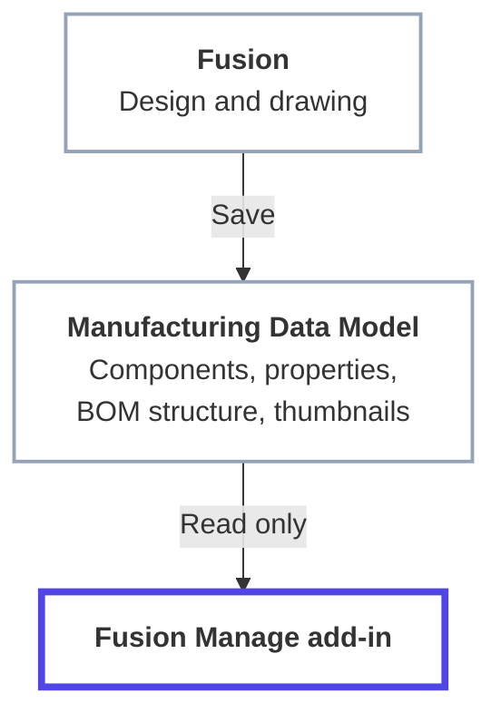

# Manufacturing Data Model

The Manufacturing Data Model is the source of everything the add-in publishes. This page explains what it is, what the add-in reads from it, and what has to be true of your design for the data to be there. How that data is then matched to Fusion Manage fields is covered in [Workspace and Field Mapping](field-mapping.md).

## What it is

When you save a design in Fusion, Autodesk stores a structured description of it in the cloud: its components, their properties, the BOM structure that relates them, and their thumbnails. That cloud description is the Manufacturing Data Model. It is exposed through an Autodesk Platform Services (APS) API.

The add-in uses it as a **read-only** source. It never writes to it.

### Why the add-in reads from the cloud

Reading the cloud description, rather than asking the open Fusion document, has practical benefits:

- A publish runs in the background. It does not freeze Fusion, and **the design does not need to stay open** while it runs.
- Properties of every component, at every level of the assembly, are available without opening each one.
- The same signed-in session reads the Data Model and writes to Fusion Manage, so there is no second login. The `data:read` scope covers it.

!!! note "The add-in reads what has been saved"
    Because the source is the saved cloud version of the design, changes you have not saved are not seen. A design that Fusion has not finished processing may also be incomplete. Save, and let the design finish processing, before you publish or compare.

## What the add-in reads

| Data | What it is | Used for |
|---|---|---|
| **Component summary** | The top-level component's item number, part number, description and name | Identifying the item, and the title of the Publish panel |
| **Properties** | Every property of a component: base properties that ship with the Data Model and custom properties your organisation has defined | The values you map to Fusion Manage fields |
| **Physical properties** | Mass, volume, area, density and the bounding box (length, width, height), worked out from the geometry | Mapped fields, when you choose to map them |
| **BOM structure** | Every component below the top level, with quantities and sequence numbers, down to ten levels | The Bill of Materials comparison and publish |
| **Thumbnail** | An image of each component | The item's image field, when mapped |
| **Fusion Manage link** | The Fusion Manage item a component is already linked to, if its Item Number carries that hyperlink in Fusion | Component linking when publishing |

### Part number

The **part number** is the key to everything. It becomes the **item number** in Fusion Manage, and it is how the add-in decides whether an item already exists. A component with no part number cannot be published. See [End-to-End Workflow](../getting-started/workflow.md).

### Properties

Properties are read for each component, up to 500 per component.

!!! example "Screenshot placeholder: Component properties in Fusion"
    **Show:** A component's properties in Fusion with the custom Type property set.

    Save the image as `docs/images/component-properties.png`, then replace this box with ``.

- **Base properties** ship with the Data Model, for example name, description, part number and material.
- **Custom properties** come from property collections that an administrator has linked to your hub. The properties offered when you map fields are the ones defined for your hub and applicable to components. Hidden and archived properties are not offered.

To change what is published, change the property on the component in Fusion, save, and publish again. The Data Model is where the value lives, and the add-in only carries it.

### Physical properties

Physical properties are not stored like ordinary properties. The Data Model calculates them from the geometry, and they are only available once that calculation has completed. The add-in reads them only if a mapping uses them, because they cost an extra request.

- A component whose physical properties are not ready yet simply has none to publish. The rest of its properties still publish.
- Mass is converted to **kilograms**, because that is the unit of the Fusion Manage weight field, whatever unit the design uses.
- Values are sent as plain numbers, without units, since a Fusion Manage number field refuses units.

### Thumbnails

A thumbnail is an image that Fusion generates for each component. The address the Data Model gives for it is short-lived, so the add-in asks for a fresh one at the moment it publishes the item. A component whose thumbnail has not been generated yet is published without an image, and the run records that.

## Which design is read

The add-in reads the **design that is open in Fusion**, in the Autodesk hub you are working in. For a drawing it follows the drawing's reference to the design it shows. Each component's data is read from the saved version of that design.

## Before you publish

- [ ] The design is saved to the cloud.
- [ ] Fusion has finished processing it.
- [ ] Every component that should become an item has a part number.
- [ ] The properties you plan to map are filled in on the components.
- [ ] If you map physical properties, they have finished calculating.

## Next step

Tell the add-in which Fusion Manage workspace to write to and which property fills which field: [Workspace and Field Mapping](field-mapping.md).
