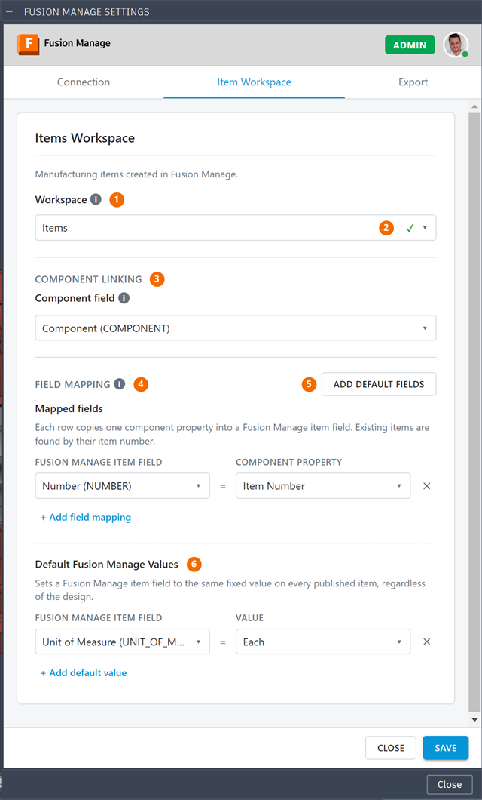
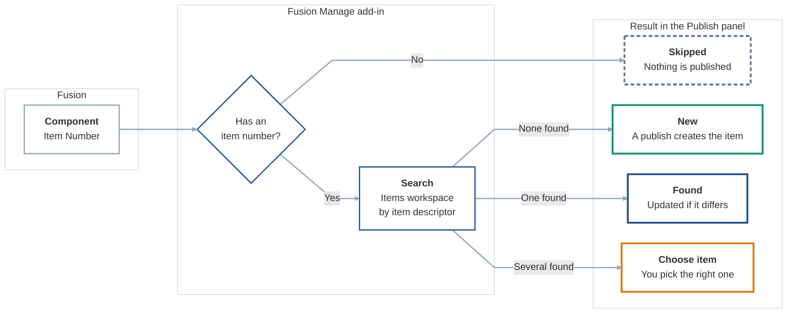
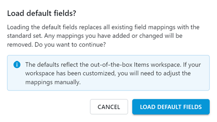
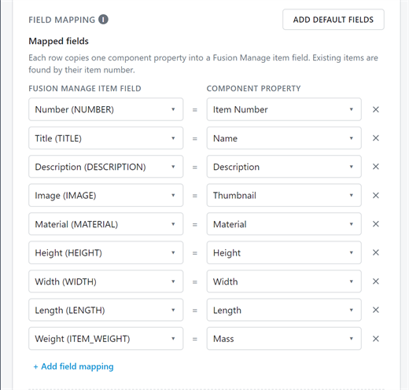
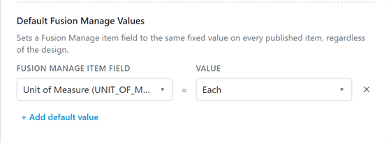
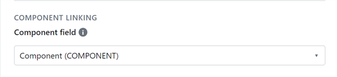
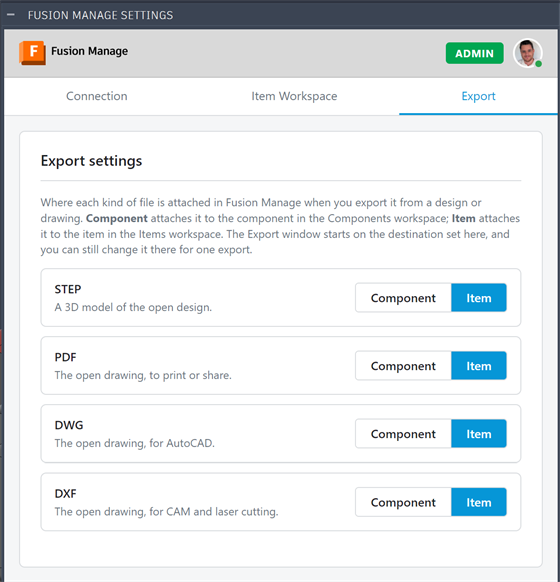

# Configuration

**What you'll do here:** set up the **Item Workspace** and **Export** tabs of Preferences: which Fusion Manage workspace the add-in writes to, which design property fills which field, and where exported files are attached. Do it once, before the first publish. The **Connection** tab is covered in [Installation and Authentication](../getting-started/installation.md#3-configure-the-connection).

## Quick steps

1. [Sign in](../getting-started/installation.md) and connect to your tenant.
2. Open **Manage ▸ Item Management ▸ Administration ▸ Preferences ▸ Item Workspace**.
3. Choose your **Items workspace** and wait for the tick.
4. Click **Add default fields**, and check the rows that appear (up to nine, one for each field your workspace has) ([Default fields](#default-fields)).
5. Click **Save**.

If a picklist field is mapped, its values must match in both systems ([Picklists](#picklists)). Unfamiliar words are in the [Glossary](../getting-started/glossary.md).

## In this page

| Section | Read it when |
|---|---|
| [Item Workspace](#item-workspace) | You are choosing the workspace, mapping fields, setting default values or linking components. |
| [Export destinations](#export-destinations) | You want STEP, PDF, DWG or DXF files to attach to an item or a component. |

To know what the add-in reads from your design, and what must be true of it first, see [Manufacturing Data Model](../reference/manufacturing-data-model.md).

## Item Workspace

This section covers the **Item Workspace** tab of **Preferences**: which Fusion Manage workspace the add-in writes to, and how each property it reads from the [Manufacturing Data Model](../reference/manufacturing-data-model.md) is mapped to a field there. The mapping of properties to fields is described under [Field mapping](#field-mapping).

You normally set it up once, then share it with colleagues through the hub ([Save to Fusion Hub](../getting-started/installation.md#save-to-fusion-hub)).

### The Items workspace

The add-in currently works with one workspace kind, **Items** ("Manufacturing items created in Fusion Manage"). On the **Item Workspace** tab you will find a card for it with the parts below. The numbers in the screenshot match the table.

<div class="side-by-side" markdown="1">
<div markdown="1">

| # | Part | What it does |
|---|---|---|
| 1 | **Workspace** | A drop-down of the **Revision Controlled Workspace** type in your tenant, and no other type. Choose the one that holds your items by name ([Which workspaces are listed](#which-workspaces-are-listed)). |
| 2 | **Validation** | Happens automatically when you pick a workspace or open the tab. It checks the workspace and loads its field list so the pickers below can show real field names. The mapping controls stay disabled until the workspace validates (a tick appears next to the workspace). |
| 3 | **Component linking** | Optional, see [Component linking](#component-linking). |
| 4 | **Field mapping** | Which Data Model property fills which Fusion Manage field. Each row pairs one with the other ([Field mapping](#field-mapping)). |
| 5 | **Add default fields** | At the top right of the Field mapping section. It fills the list with the standard nine mappings instead of you adding them one at a time. It is the quickest start, and it replaces the rows already there ([Default fields](#default-fields)). |
| 6 | **Default Fusion Manage Values** | Fields set to a fixed value on every published item ([Default Fusion Manage Values](#default-fusion-manage-values)). |

Click **Save** when you are done. Saving is refused while the settings have problems, and the message says what to fix.

</div>
<div markdown="1">

{ width="640" height="1060" }

</div>
</div>

#### Which workspaces are listed

The **Workspace** drop-down does not list every workspace in your tenant. It lists only workspaces whose workspace type in Fusion Manage is **Revision Controlled Workspace**, under the heading "Revision Controlled Workspaces". Items in a workspace of this type have revisions and a lifecycle, which is what the add-in publishes to.

Some workspaces are left out on purpose:

- Workspaces of any other workspace type.
- Workspaces that Fusion Manage marks as *controlled*, such as Components and Drawings, which do not hold the items you publish.
- Deleted workspaces.

If your Items workspace is missing from the list, its type is the usual reason. The drop-down then says "No revision controlled workspaces found" if there are none at all, or shows the reason the list could not be read. Ask your Fusion Manage administrator to check the type of the workspace.

### Field mapping

Each row of **Mapped fields** pairs a Fusion Manage item field (left) with the component property that fills it (right):

| Column | Meaning |
|---|---|
| **Fusion Manage Item Field** | The Fusion Manage field it fills, shown with its title and ID. |
| **Component Property** | The source: a Data Model property. |

#### Available sources

- **Built-in fields**: Item Number, Part number, Name, Description, Revision, Material, Lifecycle state and Thumbnail. **Item Number** is the one that matters most: see [The item number](#the-item-number).
- **Custom and base properties**: any property defined on your Manufacturing Data Model items can be mapped by name.
- **Physical properties**: Mass, Volume, Area, Density, Length, Width and Height (Length, Width and Height are the bounding box). They are read only when a mapping uses them.

#### The item number

!!! important "The item number is the key to everything"
    The add-in decides whether to create or update an item by looking for its **item number** in your Items workspace. Two things must be true:

    1. **In the add-in:** **Item Number** is mapped to the Fusion Manage field that holds it, usually `NUMBER`. **Add default fields** does this for you.
    2. **In Fusion Manage:** that field is **part of the item descriptor** of the Items workspace. The add-in finds items by searching their descriptor, so an item whose descriptor does not include the number cannot be found ([How the search matches](#how-the-search-matches)).

```
Component property        Fusion Manage item field
Item Number         =     Number (NUMBER)
```

!!! warning "Item Number is not Part number"
    **Part number** is a separate component property that you can map to any field you like, but it is never used to match items. The add-in uses it only to find the component you selected in the open design ([Manufacturing Data Model](../reference/manufacturing-data-model.md#item-number-and-part-number)). Matching always uses **Item Number**.

How the item number is used:

| Rule | What it means | If it is not met |
|---|---|---|
| **Item Number must be mapped** | One row with the component property **Item Number** and the Fusion Manage field that holds the item number (usually `NUMBER`). | Saving is refused: *Item Number is not mapped. Add a mapped field with the Component Property 'Item Number' and the Fusion Manage Item Field 'NUMBER'.* The workspace is reported as not set up, and the ribbon buttons stay greyed out. |
| **The number must be in the descriptor** | In Fusion Manage, the Items workspace's item descriptor must include the item number field (`NUMBER`), at the start. Titles and other fields may follow, set off by ` - `. This is set in Fusion Manage, not in the add-in, and the add-in cannot check it. | Existing items are not found and show as **New**. |
| **It is mapped once** | A component property can be mapped once, and a Fusion Manage field filled once. | The settings report the duplicate and will not save. |
| **Items are found by it** | At publish, the add-in searches the Items workspace for the component's item number, against each item's **descriptor** ([below](#how-the-search-matches)). Nothing else is used to match. | See the outcomes below. |
| **A component needs one** | A component with no item number cannot be published or opened in the Item Panel. | It is **Skipped**, and so is everything below it in the BOM. |

##### How the search matches

Fusion Manage identifies each item by its **descriptor**, the name it shows for the item, which each workspace builds from its fields. The add-in searches the descriptor for the item number. The number of an item is read as the part of its descriptor before ` - `, compared without capitals and without spaces at the ends. So a descriptor can carry more after the number, set off by ` - `:

| Item descriptor in Fusion Manage | Item number searched | Matches |
|---|---|---|
| `PN-1001` | `PN-1001` | Yes |
| `PN-1001 - Bracket` | `PN-1001` | Yes: the number is the part before ` - ` |
| `pn-1001 - Bracket` | `PN-1001` | Yes: capitals are ignored |
| `Bracket` | `PN-1001` | No: the descriptor does not start with the number |

!!! warning "Check your workspace's descriptor"
    The item number field (`NUMBER`) must be part of the Items workspace's descriptor, at the start. A descriptor built another way, for example from the title alone, means the add-in will not find items that already exist. It shows those components as **New**, so a publish would try to create them again. Ask your Fusion Manage administrator to check the **item descriptor** of the Items workspace before your first publish.

What happens to each component when the add-in searches for its item number:



!!! note "Settings saved by an older version"
    Earlier versions mapped **Part number** to `NUMBER`. When such settings are opened, that row is changed to **Item Number** for you, so they keep working.

For how each outcome is shown and handled while publishing, see [Item Update](../publishing/index.md#item-update) and the BOM statuses in [Publishing](../publishing/index.md).

#### Rules the settings enforce

- A workspace must be chosen from the **Workspace** drop-down. You pick it by name; the add-in works out the rest.
- Every row needs both a source and a Fusion Manage field.
- **Item Number** must be mapped to the Fusion Manage field that holds it ([The item number](#the-item-number)).
- A source can be mapped only once, and a Fusion Manage field can be filled only once, whether by a mapping, a default value or the component-linking field.

#### Data types: how a value is fitted to its field

A component property reaches the add-in as a value, and the Fusion Manage field it is mapped to has a **data type**. The add-in looks at the type of the target field and fits the value to it before sending. Nothing is configured for this: it follows from the field you map to.

| Component property | Fusion Manage field | What the add-in does |
|---|---|---|
| Text, such as Name, Description or a custom text property | Text field | Sent as it is. |
| A picklist value, such as a single select custom property (**Type**) | Picklist field | Finds the picklist option with the same text and sends a link to that option ([Picklists](#picklists)). |
| A number, such as a custom number property | Number field | Rounded to the decimal places the field takes ([Numbers](#numbers)). |
| A physical property: Mass, Volume, Area, Density, Length, Width or Height | Number field, usually with a unit | Converted to the unit the field is set to, then rounded and sent as a plain number ([Physical properties](#physical-properties-and-units)). |
| Thumbnail | Image field | Sent as an image file ([Thumbnail](#thumbnail)). |
| Any other value | Any other field | Sent as text, with no conversion. |

##### Picklists

A picklist field in Fusion Manage does not accept text. It takes a link to one of its options. So when the target is a picklist, the add-in reads the field's options and looks for the one whose title matches the value, ignoring capitals and spaces at either end.

| Value from Fusion | Options in Fusion Manage | Result |
|---|---|---|
| `Top Level Assembly` | `Top Level Assembly`, `Part` | Sent: the matching option |
| `top level assembly ` | `Top Level Assembly`, `Part` | Sent: capitals and end spaces are ignored |
| `Assembly` | `Top Level Assembly`, `Part` | Not sent: there is no such option |

A value with no matching option is **left out**, because Fusion Manage would refuse the whole item for it. The item is still published without that field, and the run's files record: *'Assembly' is not an option of TYPE in Fusion Manage, so it was not sent.* See [Troubleshooting and Limitations](../reference/troubleshooting.md).

This is why a picklist in Fusion (a single select custom property) and the picklist in Fusion Manage it is mapped to must hold the same values. The same applies to a [default value](#default-fusion-manage-values) set on a picklist field, where you choose from the field's own options.

##### Numbers

A number field refuses more decimal digits than its **precision** (the number of decimal places set on the field in Fusion Manage). The add-in rounds the value to that many places (halves round up) before sending it.

| Value from Fusion | Field precision | Sent |
|---|---|---|
| `0.104455` | 3 decimal places | `0.104` |
| `12.5` | 0 decimal places | `13` |
| `12.5` | no limit set | `12.5` |

The same rounding is used when comparing. A Fusion value of `0.104455` against `0.104` already in Fusion Manage is shown as a **match**, not a change, so rounding alone never causes an update.

##### Physical properties and units

The Data Model gives a physical property in Fusion's own units: centimetres for lengths, areas and volumes, and kilograms for mass. A Fusion Manage number field can be set to a unit of its own, for example millimetres. When it is, the add-in converts the value to that unit before rounding and sending it.

| Fusion gives | Field is set to | Sent |
|---|---|---|
| `10 cm` (Length) | millimetres | `100` |
| `2.5 kg` (Mass) | grams | `2500` |
| `0.5 kg` (Mass) | pounds | `1.1` (rounded to the field's precision) |

- Conversion covers length (mm, cm, m, in, ft), mass (mg, g, kg, oz, lb) and their square, cubic and per-volume forms (area, volume, density). It only converts between units of the same kind.
- If the field **states no unit**, or its unit is one the add-in does not know, or it measures something different, the value is **sent unchanged** and a warning is logged.
- Only the number is sent, with no unit, because a Fusion Manage number field refuses text such as `10 mm`.

!!! tip "Set the unit on the field"
    To receive a value in millimetres, set the field's unit to millimetres in Fusion Manage. The add-in converts to whatever the field says, so a field with no unit receives Fusion's own centimetres and kilograms as they are.

##### Thumbnail

An image field takes a file, not text. The add-in fetches a fresh thumbnail when it publishes the item and sends it as an image. An image cannot be compared with what is already there, so it is sent with any create, and with any update that has another difference.

### Default fields

**Add default fields** loads the standard set of mappings in one click, so you do not build them row by row. It is the fastest way to set up a workspace that follows the out-of-the-box layout.

To use it:

1. Choose your Items workspace and wait for the tick. The button needs the workspace to be validated, so it knows which fields exist.
2. Click **Add default fields** and read the **Load default fields?** question.
3. Click **Load default fields** to go ahead, or **Cancel** to leave your mappings as they are.
4. Check the **Mapped fields** list, adjust it if you need to, then click **Save**. The rows are only on screen until you save.

{ width="440" height="248" }

!!! warning "It replaces your mappings"
    Loading the defaults **replaces all existing field mappings** with the standard set. Any mapping you added or changed is removed. A confirmation (**Load default fields?**) asks first, and you can cancel. Default Fusion Manage Values and the component-linking field are not part of the defaults.

#### What is added

| # | Data Model source | Fusion Manage field ID | Notes |
|---|---|---|---|
| 1 | Item Number | `NUMBER` | Required. Existing items are found by their item number |
| 2 | Name | `TITLE` | |
| 3 | Description | `DESCRIPTION` | |
| 4 | Thumbnail | `IMAGE` | The component's image, sent as a file |
| 5 | Material | `MATERIAL` | Read from the Data Model's `materialName` |
| 6 | Physical Height | `HEIGHT` | Bounding box |
| 7 | Physical Width | `WIDTH` | Bounding box |
| 8 | Physical Length | `LENGTH` | Bounding box |
| 9 | Physical Mass | `ITEM_WEIGHT` | Converted to the field's unit |

Dimensions and mass are converted to the unit each Fusion Manage field is set to, and sent as plain numbers ([Physical properties and units](#physical-properties-and-units)). Physical properties are only available once the Data Model has finished calculating them ([Manufacturing Data Model](../reference/manufacturing-data-model.md#physical-properties)).

#### Which fields your workspace needs

Each default writes to a Fusion Manage field **by its field ID**. Only one of the nine is required:

| Field ID | Needed? | Why |
|---|---|---|
| `NUMBER` | **Required** | It holds the item number, which is how items are found ([The item number](#the-item-number)). |
| `TITLE`, `DESCRIPTION`, `IMAGE`, `MATERIAL`, `HEIGHT`, `WIDTH`, `LENGTH`, `ITEM_WEIGHT` | Optional | Each is only filled if your workspace has a field with that ID. Without it, that mapping is simply not made, and nothing else is affected. |

The add-in does not depend on any other field IDs. Map the fields you want published, and leave out the rest.

!!! note "Fusion Manage's own required fields"
    If your Items workspace marks other fields as required in Fusion Manage, a new item needs a value for each. Map them, or give them a [default value](#default-fusion-manage-values). The add-in does not check this in advance: Fusion Manage refuses an item that lacks one, and the run records its reason.

!!! important "Missing fields are skipped, not reported"
    Once the workspace has been validated, **Add default fields** leaves out any default whose field ID does not exist in your workspace. It does not warn you. If you load the defaults and a row you expected is missing, the field is missing, or its ID is different, in Fusion Manage.

Check the result after loading: the **Mapped fields** list shows a row for each default your workspace has a field for, up to nine. If your workspace has been customised, add or correct the missing rows by hand.

{ width="520" height="496" }

### Default Fusion Manage Values

A default value sets a Fusion Manage item field to the same value on every published item, regardless of the design. Choose **Add default value**, pick the field, then enter or choose the value (a picklist field offers its options). For an existing item, a default value is applied when the item lacks it.

{ width="560" height="206" }

### Component linking

If your Items workspace has a field that links an item to a record in the Fusion Manage components picklist, choose it under **Component linking** (**Choose the linking field…**). When publishing, the add-in links each item to its component: first through the link stored in the Data Model, and if there is none, by searching the component picklist for the item number. If neither finds it, the item is still published and the step is recorded as a failed "component link" in the run's files.

{ width="560" height="128" }

### When the buttons light up

The ribbon and context-menu buttons, other than **Preferences** and **Export**, stay disabled until the Items workspace is usable: a workspace is chosen, and the mappings are valid. The tooltip says what is still missing. The **Export** window opens either way; it turns off only its **Item** destination, and says why.

## Export destinations

The **Export** tab of **Preferences** decides where each exported file is attached in Fusion Manage. You choose a destination for each file format, and it is the one the **Export** window starts on.

<div class="side-by-side" markdown="1">
<div markdown="1">

| Format | What it is | Made from |
|---|---|---|
| **STEP** | A 3D model | The open design |
| **PDF** | To print or share | The open drawing |
| **DWG** | For AutoCAD | The open drawing |
| **DXF** | For CAM and laser cutting | The open drawing |

Each format has two choices:

| Destination | The file is attached to | In the workspace |
|---|---|---|
| **Item** | The item of the component | Items |
| **Component** | The component record | Components |

Every format starts on **Item**. Click **Save** after changing one.

</div>
<div markdown="1">

{ width="560" height="582" }

</div>
</div>

#### How the Export window uses it

The **Export** window starts on the destination you set here for the format you pick. You can still choose the other one for a single export, and the setting is not changed.

The window starts on the other destination instead when the one you set cannot be used:

- **The Items workspace is not set up**, so **Item** is off. The window says so.
- **The connection is incomplete**, so **Component** is off. The window says so, and asks you to complete it in Preferences.
- **You may not attach files there.** Attaching needs View Items, Add Attachments and Edit Attachments in that workspace ([Permissions in Fusion Manage](../getting-started/installation.md#permissions-in-fusion-manage)).
- **No workspace called Components is found** in Fusion Manage, so **Component** is off.

The window opens either way, and turns off only the destination that cannot be used, with its reason. For how to export, see [The Export Window](../publishing/index.md#the-export-window).
