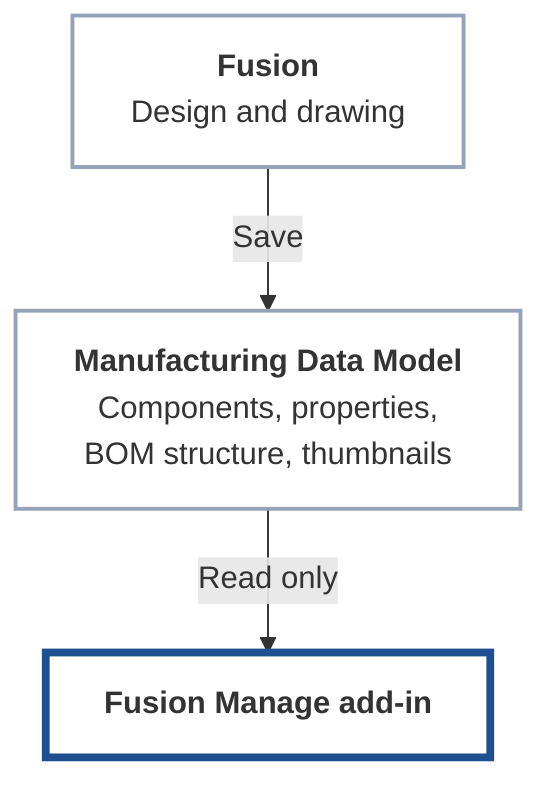
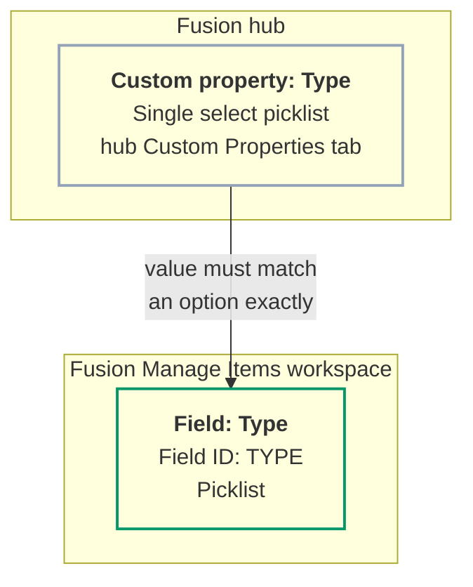

# Configuration

Configuration tells the add-in where design data comes from and where in Fusion Manage it goes. Do it once, before the first publish.

## Order of work

1. Sign in and connect to your tenant. See [Installation and Authentication](../getting-started/installation.md).
2. Check that the design data is ready to publish. See [Manufacturing Data Model](#manufacturing-data-model).
3. Choose the Items workspace and map the fields. See [Workspace and Field Mapping](#workspace-and-field-mapping).

## Manufacturing Data Model

The Manufacturing Data Model is the source of everything the add-in publishes. This page explains what it is, what the add-in reads from it, and what has to be true of your design for the data to be there. How that data is then matched to Fusion Manage fields is covered in [Workspace and Field Mapping](#workspace-and-field-mapping).

### What it is

When you save a design in Fusion, Autodesk stores a structured description of it in the cloud: its components, their properties, the BOM structure that relates them, and their thumbnails. That cloud description is the Manufacturing Data Model. It is exposed through an Autodesk Platform Services (APS) API.

The add-in uses it as a **read-only** source. It never writes to it.

#### Why the add-in reads from the cloud

Reading the cloud description, rather than asking the open Fusion document, has practical benefits:

- A publish runs in the background. It does not freeze Fusion, and **the design does not need to stay open** while it runs.
- Properties of every component, at every level of the assembly, are available without opening each one.
- The same signed-in session reads the Data Model and writes to Fusion Manage, so there is no second login. The `data:read` scope covers it.

!!! note "The add-in reads what has been saved"
    Because the source is the saved cloud version of the design, changes you have not saved are not seen. A design that Fusion has not finished processing may also be incomplete. Save, and let the design finish processing, before you publish or compare.

### What the add-in reads

| Data | What it is | Used for |
|---|---|---|
| **Component summary** | The top-level component's item number, part number, description and name | Identifying the item, and the title of the Publish panel |
| **Properties** | Every property of a component: base properties that ship with the Data Model and custom properties your organisation has defined | The values you map to Fusion Manage fields |
| **Physical properties** | Mass, volume, area, density and the bounding box (length, width, height), worked out from the geometry | Mapped fields, when you choose to map them |
| **BOM structure** | Every component below the top level, with quantities and sequence numbers, down to ten levels | The Bill of Materials comparison and publish |
| **Thumbnail** | An image of each component | The item's image field, when mapped |
| **Fusion Manage link** | The Fusion Manage item a component is already linked to, if its Item Number carries that hyperlink in Fusion | Component linking when publishing |

#### Part number

The **part number** is the key to everything. It becomes the **item number** in Fusion Manage, and it is how the add-in decides whether an item already exists. A component with no part number cannot be published. See [End-to-End Workflow](../getting-started/workflow.md).

#### Properties

Properties are read for each component, up to 500 per component.

!!! example "Screenshot placeholder: Component properties in Fusion"
    **Show:** A component's properties in Fusion with the custom Type property set.

    Save the image as `docs/images/component-properties.png`, then replace this box with ``.

- **Base properties** ship with the Data Model, for example name, description, part number and material.
- **Custom properties** come from property collections that an administrator has linked to your hub. The properties offered when you map fields are the ones defined for your hub and applicable to components. Hidden and archived properties are not offered.

To change what is published, change the property on the component in Fusion, save, and publish again. The Data Model is where the value lives, and the add-in only carries it.

#### Physical properties

Physical properties are not stored like ordinary properties. The Data Model calculates them from the geometry, and they are only available once that calculation has completed. The add-in reads them only if a mapping uses them, because they cost an extra request.

- A component whose physical properties are not ready yet simply has none to publish. The rest of its properties still publish.
- Mass is converted to **kilograms**, because that is the unit of the Fusion Manage weight field, whatever unit the design uses.
- Values are sent as plain numbers, without units, since a Fusion Manage number field refuses units.

#### Thumbnails

A thumbnail is an image that Fusion generates for each component. The address the Data Model gives for it is short-lived, so the add-in asks for a fresh one at the moment it publishes the item. A component whose thumbnail has not been generated yet is published without an image, and the run records that.

### Which design is read

The add-in reads the **design that is open in Fusion**, in the Autodesk hub you are working in. For a drawing it follows the drawing's reference to the design it shows. Each component's data is read from the saved version of that design.

### Before you publish

- [ ] The design is saved to the cloud.
- [ ] Fusion has finished processing it.
- [ ] Every component that should become an item has a part number.
- [ ] The properties you plan to map are filled in on the components.
- [ ] If you map physical properties, they have finished calculating.

### Next step

Tell the add-in which Fusion Manage workspace to write to and which property fills which field: [Workspace and Field Mapping](#workspace-and-field-mapping).

## Workspace and Field Mapping

The add-in reads each component's properties from the [Manufacturing Data Model](#manufacturing-data-model). This page explains how you tell it where to put them: which Fusion Manage workspace to write to, and which Data Model property fills which Fusion Manage field. That is called the **mapping**, and you set it on the **Workspaces** tab of **Preferences**.

You normally set it up once, then share it with colleagues by export and import ([Installation and Authentication](../getting-started/installation.md#sharing-a-setup-with-colleagues)).

### The Items workspace

The add-in currently works with one workspace kind, **Items** ("Manufacturing items created in Fusion Manage"). On the **Workspaces** tab you will find a card for it with:

1. **Items Workspace ID**: the numeric ID of the workspace in your tenant, for example `83`.
2. **Validate**: checks the workspace and loads its field list so the pickers below can show real field names. The mapping controls stay disabled until the workspace validates (a tick appears next to the ID).
3. **Component linking**: optional, see below.
4. **Field mapping**: which Data Model property fills which Fusion Manage field. **Add default fields** loads the standard set (see [Default fields](#default-fields)).
5. **Static values**: fields set to a fixed value on every published item.

Click **Save** when you are done. Saving is refused while the settings have problems, and the message says what to fix.

!!! example "Screenshot placeholder: Preferences, Workspaces tab with a validated Items workspace"
    **Show:** The Items card with the workspace ID, the tick after Validate, and the mapping sections.

    Save the image as `docs/images/workspaces-tab.png`, then replace this box with ``.

### Field mapping

Each row of **Mapped fields** pairs a Data Model source (left) with a Fusion Manage field (right):

| Column | Meaning |
|---|---|
| **Fusion field** | The source: a Data Model property. |
| **Manage field** | The Fusion Manage field it fills, shown with its title and ID. |
| **Key** | The *match key*: the one mapping used to find an existing item so it is updated rather than duplicated. |

#### Available sources

- **Built-in fields**: Part number, Name, Description, Revision, Material, Lifecycle state and Thumbnail.
- **Custom and base properties**: any property defined on your Manufacturing Data Model items can be mapped by name.
- **Physical properties**: Mass, Volume, Area, Density, Length, Width and Height (Length, Width and Height are the bounding box). They are read only when a mapping uses them.

#### Rules the settings enforce

- The workspace ID must be a number.
- Every row needs both a source and a Fusion Manage field.
- A source can be mapped only once, and a Fusion Manage field can be filled only once, whether by a mapping, a static value or the component-linking field.
- Exactly one mapping must be the **Key**. Only property values can be the key; the thumbnail and physical properties cannot.

#### Picklist and number fields

If the target field is a picklist, the add-in looks up the picklist's options and sends the matching option. A value with no matching option is left out and reported (see [Troubleshooting and Limitations](../reference/troubleshooting.md)). Numeric values are rounded to the precision the Fusion Manage field takes.

### Default fields

**Add default fields** loads the standard set of mappings in one click, so you do not build them row by row. It is the fastest way to set up a workspace that follows the out-of-the-box layout.

!!! example "Screenshot placeholder: Load default fields confirmation"
    **Show:** The Add default fields button and the Load default fields? confirmation.

    Save the image as `docs/images/load-defaults-dialog.png`, then replace this box with ``.

!!! warning "It replaces your mappings"
    Loading the defaults **replaces all existing field mappings** with the standard set. Any mapping you added or changed is removed. A confirmation (**Load default fields?**) asks first, and you can cancel. Static values and the component-linking field are not part of the defaults.

#### What is added

| # | Data Model source | Fusion Manage field ID | Notes |
|---|---|---|---|
| 1 | Part number | `NUMBER` | The **Key**: how an existing item is found and updated rather than duplicated |
| 2 | Name | `TITLE` | |
| 3 | Description | `DESCRIPTION` | |
| 4 | Thumbnail | `IMAGE` | The component's image, sent as a file |
| 5 | Material | `MATERIAL` | Read from the Data Model's `materialName` |
| 6 | Custom property `Type` | `TYPE` | A picklist. See [the Type field](#the-type-field-and-its-picklist) |
| 7 | Physical Height | `HEIGHT` | Bounding box |
| 8 | Physical Width | `WIDTH` | Bounding box |
| 9 | Physical Length | `LENGTH` | Bounding box |
| 10 | Physical Mass | `ITEM_WEIGHT` | Converted to kilograms |

Dimensions are sent as plain numbers in the unit the Data Model reports. Only mass is converted, to kilograms, because that is the unit of the Fusion Manage weight field. Physical properties are only available once the Data Model has finished calculating them ([Manufacturing Data Model](#physical-properties)).

#### Fields your workspace must have

Each default writes to a Fusion Manage field **by its field ID**, so the workspace must contain a field with that exact ID: `NUMBER`, `TITLE`, `DESCRIPTION`, `IMAGE`, `MATERIAL`, `TYPE`, `HEIGHT`, `WIDTH`, `LENGTH` and `ITEM_WEIGHT`.

!!! important "Missing fields are skipped, not reported"
    Once the workspace has been validated, **Add default fields** leaves out any default whose field ID does not exist in your workspace. It does not warn you. If you load the defaults and a row you expected is missing, the field is missing, or its ID is different, in Fusion Manage.

Check the result after loading: the **Mapped fields** list should show all ten rows. If your workspace has been customised, add or correct the missing rows by hand.

!!! example "Screenshot placeholder: Mapped fields after Add default fields"
    **Show:** The ten default mappings in the Mapped fields list, with the Key on Part number.

    Save the image as `docs/images/mapped-fields-defaults.png`, then replace this box with ``.

#### The Type field and its picklist

The `Type` default connects two systems, and **the values must be identical in both** for it to map. If they differ, the value cannot be sent.

| | Fusion (Manufacturing Data Model) | Fusion Manage |
|---|---|---|
| **Where** | The **Custom Properties** tab of your hub settings | The Items workspace, in workspace settings |
| **Name** | `Type` | `Type` |
| **Field ID** | not applicable | `TYPE` |
| **Field type** | Single select picklist | Picklist |
| **Values** | The picklist values | The picklist options. **The same list.** |

##### 1. Configure the custom property in Fusion

!!! example "Screenshot placeholder: Fusion hub: Type custom property"
    **Show:** Hub Custom Properties, Edit property for Type, with Single select picklist and its values.

    Save the image as `docs/images/hub-type-property.png`, then replace this box with ``.

A hub administrator defines the property once for the whole hub.

1. In your Autodesk hub settings, open the **Custom Properties** tab (the tabs are Hub Settings, Members, Groups, Projects, Numbering and Custom Properties).
2. Add or edit a property (**Edit property**) with:
    - **Name:** `Type`
    - **Field type:** **Single select picklist**
3. Under **Picklist values**, use **Add picklist value** to enter each value.
4. Save. The property is then available on your components, where designers choose a Type.

##### 2. Configure the field in Fusion Manage

In the Items workspace, add a picklist field named **Type** with field ID **`TYPE`**, and give its picklist **the same options**.

!!! example "Screenshot placeholder: Fusion Manage: Type field and its picklist values"
    **Show:** The Type field in the Items workspace, field ID TYPE, with its picklist options.

    Save the image as `docs/images/fm-type-field.png`, then replace this box with ``.

##### 3. Keep the values identical

These are the values in use. Both systems must have every one of them:

| Picklist values |
|---|
| Electrical |
| Manufacturing |
| Mechanical |
| Others |
| Packaging |
| Raw Material |
| Service BOM |
| Service Kit |
| Software |
| Spare Parts List |
| Top Level Assembly |

- **Spell each value the same way in both systems.** The add-in ignores capital letters and spaces at either end when it compares, so `raw material` still matches `Raw Material`. Any other difference, such as `Raw Materials` or `Spare Parts`, does not match. Do not rely on the leniency: copy the value exactly.
- **Order does not matter.** Only the set of values does.
- **A value in Fusion that is not in Fusion Manage** is not sent. The rest of the item still is, and the run records *'…' is not an option of TYPE in Fusion Manage, so it was not sent*. See [Troubleshooting and Limitations](../reference/troubleshooting.md).
- **A value in Fusion Manage that is not in Fusion** can never be chosen by a designer, so it never arrives from a publish. It can only be set in Fusion Manage by hand.

!!! warning "Check both lists before you publish"
    The two picklists are maintained separately, so they drift apart. In particular, a value added to one system and forgotten in the other is the most common cause of a Type that does not appear in Fusion Manage. Compare the lists whenever either one changes.

##### Adding a new Type later

The picklist is not fixed. You can extend it as your organisation needs, provided both systems are changed together:

1. Add the new value to the `Type` picklist on the hub's **Custom Properties** tab.
2. Add the **same value** to the `TYPE` picklist options in Fusion Manage.
3. Choose the new Type on the components, save, and publish again.

Do the Fusion Manage change **first** if you can. That way a component given the new Type can be published straight away, instead of having its Type skipped until the option exists.

The same rule applies to **any picklist field** you map: the Fusion custom property and the Fusion Manage field must offer the same values. `Type` is simply the one included in the defaults.

The Item panel shows an item's Type in the line under its title, next to its version and lifecycle, so the field is worth having even if you map nothing else.

### Static values

A static value sets a Fusion Manage field to the same value on every published item, regardless of the design. Pick the field, then enter or choose the value (a picklist field offers its options). For an existing item, a static value is applied when the item lacks it.

!!! example "Screenshot placeholder: Static values"
    **Show:** A static value row, with a Fusion Manage field and its value.

    Save the image as `docs/images/static-values.png`, then replace this box with ``.

### Component linking

If your Items workspace has a field that links an item to a record in the Fusion Manage components picklist, choose it under **Component linking** (**Choose the linking field…**). When publishing, the add-in links each item to its component: first through the link stored in the Data Model, and if there is none, by searching the component picklist for the item number. If neither finds it, the item is still published and the step is recorded as a failed "component link" in the run's files.

!!! example "Screenshot placeholder: Component linking field"
    **Show:** The Choose the linking field picker.

    Save the image as `docs/images/component-linking.png`, then replace this box with ``.

### When the buttons light up

The ribbon and context-menu buttons, other than **Preferences**, stay disabled until the Items workspace is usable: a workspace ID is set, the mappings are valid, and a match key is chosen. The tooltip says what is still missing.
