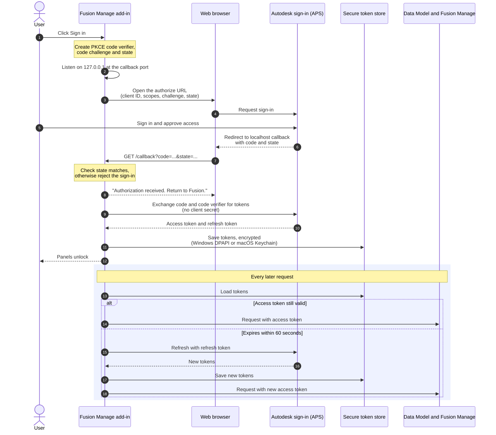

# Installation and Authentication

Setting up the add-in takes four stages. Do them in this order.

| Stage | What you do | Who |
|---|---|---|
| [1. Install the add-in](#1-install-the-add-in) | Load the add-in into Fusion | Each user |
| [2. Create an APS application](#2-create-an-aps-application-and-get-a-client-id) | Register an application and obtain a **Client ID** | Once per organisation (or per developer) |
| [3. Configure the connection](#3-configure-the-connection) | Enter the Client ID, tenant and callback port | Each user, or import a shared file |
| [4. Sign in](#4-sign-in) | Approve access in your browser | Each user |

---

## 1. Install the add-in

1. Get the add-in folder (the one containing `MfgToFm.py` and `MfgToFm.manifest`).
2. In Fusion open **Utilities ▸ Add-Ins ▸ Scripts and Add-Ins**, switch to the **Add-Ins** tab, click **+** (add existing add-in) and browse to the folder.
3. Select **MfgToFm** in the list and click **Run**. Tick **Run on Startup** if you want it to load with Fusion.

The add-in supports Windows and macOS. Once it is running, an **Export** panel and an **Item Management** panel appear in the **Manage** tab of the Design and Drawing workspaces. Most buttons stay greyed out until setup is complete.

!!! example "Screenshot placeholder: Scripts and Add-Ins dialog with MfgToFm selected"
    **Show:** The Add-Ins tab with MfgToFm selected, and the Run and Run on Startup options.

    Save the image as `docs/images/scripts-and-addins.png`, then replace this box with ``.

---

## 2. Create an APS application and get a Client ID

The add-in signs in through Autodesk Platform Services (APS), so it needs an APS application. The application's **Client ID** identifies the add-in when you sign in. This is done on the APS website, not in Fusion.

!!! info "You may already have one"
    If your organisation has already created an application for this add-in, ask for its **Client ID** and skip to [stage 3](#3-configure-the-connection). One application can be shared by everyone; each person still signs in with their own Autodesk account.

### What you need first

- An Autodesk account that can sign in at [aps.autodesk.com](https://aps.autodesk.com).
- An APS subscription (Free or Paid tier) assigned to a team.
- A **Team Administrator** to set up the APS Developer Hub, if your organisation does not have one yet.

### 2.1 Get an APS subscription (Team Administrator)

Skip this if your organisation already has an APS offering assigned to a team.

1. Go to [aps.autodesk.com](https://aps.autodesk.com) and sign in or sign up. Click **View options**.
2. On the APS overview page, use the **Site Selector** (top right) to choose your country before signing in.
3. Click **Pricing** in the left-hand menu, then **Add to Cart** under the offering you want, then **Checkout** and complete the customer details.
    - A **Free** plan is not charged, but checkout still asks for a payment method.
    - A **Paid** plan needs a valid payment method.
4. Click **Access Account**, which opens the [Autodesk Account portal](https://manage.autodesk.com/home).
5. If you administer more than one team, go to **Billing and Orders ▸ Subscriptions and Contracts** and confirm the APS offering is assigned to the right team.

!!! note
    If your region is not offered in the Autodesk Store, contact `aps.orders@autodesk.com`.

### 2.2 Create the APS Developer Hub (Team Administrator)

The Developer Hub is where your organisation's APS applications live, and where you control who can create them.

1. Open [manage.autodesk.com](https://manage.autodesk.com/).
2. Go to **Products and Services ▸ Hubs**.
3. Choose the **team** the APS offering is assigned to.
4. Click **Create Hub** and select **APS Developer Hub**.
5. Enter a **Hub Name** and click **Create & Activate**.
6. Under **Cloud Product**, click the **APS Developer Hub** link. This opens [aps.autodesk.com/hubs](https://aps.autodesk.com/hubs/).

!!! warning "No “APS Developer Hub” option?"
    The team has no APS offering assigned to it. Complete step 2.1 first.

### 2.3 Add developers to the hub (Team Administrator)

1. In the hub, open **Roles and Access**.
2. Click **Add Member** and enter the person's **email address**.
3. Choose an access level, **Admin** or **Developer**, and click **Add**.

Anyone who needs to create the application must be a member of the hub.

### 2.4 Create the application

!!! example "Screenshot placeholder: APS: choosing the application type"
    **Show:** The Create application dialog with Desktop, Mobile, Single-Page App chosen, and the callback URL field.

    Save the image as `docs/images/aps-create-application.png`, then replace this box with ``.

1. Sign in at [aps.autodesk.com](https://aps.autodesk.com) and open **My Applications**.
2. Click **Create application**.
3. When asked for the application type, choose **Desktop, Mobile, Single-Page App**.

    !!! important "Choose this type"
        The add-in signs in with PKCE and never holds a client secret. This is the type APS recommends for applications that cannot protect their credentials. Do not choose **Traditional Web App** or **Server-to-Server App**.

4. Enter an application name and description, for example *Fusion Manage Add-in*.
5. Select the APIs the add-in uses: the Manufacturing Data Model API (to read designs) and the Fusion Manage API (to write items). Select the matching entries your portal offers.
6. Set the **Callback URL** to exactly:

    ```
    http://localhost:8765/callback
    ```

    If you will use a different callback port in the add-in, use that port here instead. The two must match exactly.

7. Save the application.

!!! note "Labels can change"
    The APS portal is updated from time to time, so button names and field order may differ slightly from this list. The application type, the APIs and the callback URL are what matter.

### 2.5 Copy the Client ID

Open the application under **My Applications**. Its details page shows the **Client ID**, a 32-character string. Copy it. You will paste it into the add-in in the next stage.

!!! example "Screenshot placeholder: APS application details with the Client ID"
    **Show:** The application details page showing the Client ID. Hide or blur anything you do not want shown.

    Save the image as `docs/images/aps-client-id.png`, then replace this box with ``.

An application of this type has no client secret that you need. Never type one into the add-in.

### 2.6 Moving an existing application into the hub

If you already created the application before your organisation had a Developer Hub, move it in:

1. Sign in at [aps.autodesk.com](https://aps.autodesk.com) and open **My Applications**.
2. Select the application.
3. Click **Move apps to Developer Hub**.
4. Select the hub name and click **Next**.

You must already be a member of the hub (see [2.3](#23-add-developers-to-the-hub-team-administrator)).

!!! tip "More reading"
    This section follows Autodesk's own guide, [APS Developer Hub Setup and App Migration](https://aps.autodesk.com/blog/aps-developer-hub-setup-and-app-migration), and the post [New application types](https://aps.autodesk.com/blog/new-application-types). Refer to them if your portal looks different.

---

## 3. Configure the connection

Open **Manage ▸ Item Management ▸ Administration ▸ Preferences**. Signed out, the panel shows **Sign in to Fusion Manage** with a **Connection settings** link. Once signed in, the same fields are on the **Connection** tab.

| Setting | What to enter |
|---|---|
| **Client ID** | The Client ID from [stage 2.5](#25-copy-the-client-id). |
| **Callback port** | The port in your callback URL. Default `8765`; allowed range 1024–65535. |
| **Scopes** | Leave as `data:read data:write data:search user-profile:read`. |

The panel shows the callback URL it will use. It must be registered on your APS application exactly as shown. With the default port:

```
http://localhost:8765/callback
```

Enter the **Tenant**: the part before `.autodeskplm360.net` in your Fusion Manage address (for example `mycompany`). It must be only letters, digits and hyphens, never an address. The hub's name is not the tenant, so the add-in does not guess it. To fill it in for you, sign in, open a design linked to a Fusion Manage item and click **Find**; the add-in reads the tenant from that item's address. Click **Save** to keep it.

A Client ID, a valid port and at least one scope are required before you can sign in. Click **Save**.

!!! example "Screenshot placeholder: Preferences, Connection tab"
    **Show:** Client ID, Callback port and Scopes filled in, with the callback URL shown.

    Save the image as `docs/images/preferences-connection.png`, then replace this box with ``.

### Sharing a setup with colleagues

Each Fusion hub has its own settings, so switching hubs in Fusion switches the settings too. Only a **Hub Admin** of the hub can change them. When you open **Preferences** the add-in checks your role in the active hub.

- **Hub Admin**: click **Save**. Once the settings pass validation and are saved on this computer, you are asked whether to share them: **Save to Fusion Hub** asks for a project and folder in the hub and stores the Configuration File there (`Fusion-Manage-Item-Management-config.json`). It never contains sign-in tokens.
- **Everyone else**: the add-in asks you to find the hub's Configuration File. Click **Find Configuration File**, pick the file in the hub, and its tenant, workspaces, field mappings and exports become your settings, read-only. You still sign in with your own Client ID. The file is read again each time Preferences opens.
- A file saved from another hub is refused, and files over 1 MB or that are not an MfgToFm configuration are rejected.

---

## 4. Sign in

1. In **Preferences**, click **Sign in**.
2. Your browser opens the Autodesk sign-in page. Sign in and approve access.
3. The browser shows **Authorization received**. Return to Fusion.
4. The panel unlocks its tabs.

Sign-in waits up to 180 seconds; click **Cancel** to abort it sooner. Access tokens are refreshed automatically shortly before they expire.

!!! example "Screenshot placeholder: Preferences, Sign in to Fusion Manage"
    **Show:** The Sign in card, and the Logging in spinner with the Cancel button.

    Save the image as `docs/images/signin-card.png`, then replace this box with ``.

To sign out, use the account menu in the panel header. This removes the stored tokens for the current Client ID.

### How sign-in works

The add-in uses the OAuth 2.0 authorization-code flow with PKCE. Your password is only ever entered on the Autodesk sign-in page, never in Fusion or the add-in.



If sign-in is cancelled, rejected or times out after 180 seconds, nothing is stored. If a refresh fails, the stored tokens are cleared and you are asked to sign in again.

### How sign-in stays secure

- The add-in listens on `127.0.0.1` only, for that one redirect, and checks the `state` value to reject forged redirects.
- It uses PKCE and sends no client secret.
- Tokens are never written to the configuration file or to logs.

| Platform | Where tokens are stored |
|---|---|
| Windows | Encrypted with Windows DPAPI for your user account, in a file under `%LOCALAPPDATA%\MfgToFm`. |
| macOS | Your login Keychain. |

### Permissions in Fusion Manage

Signing in does not grant access by itself. Before publishing, the add-in checks that your Fusion Manage user holds these permissions in the Items workspace: View Items, Add Items, Edit Items, View BOM, Add To BOM and Edit BOM. Viewing an item needs only View Items. If one is missing, the message names it.

### Next step

Configure the Items workspace and field mappings: [Workspace and Field Mapping](../configuration/index.md#workspace-and-field-mapping).
