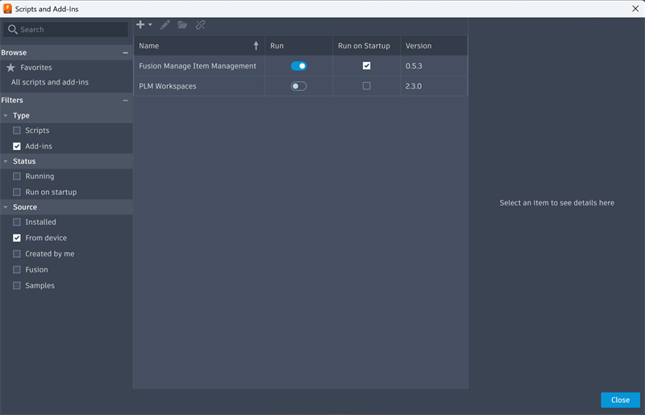
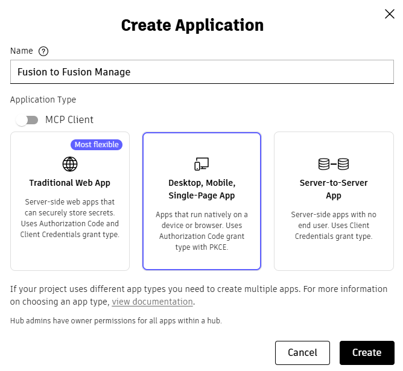
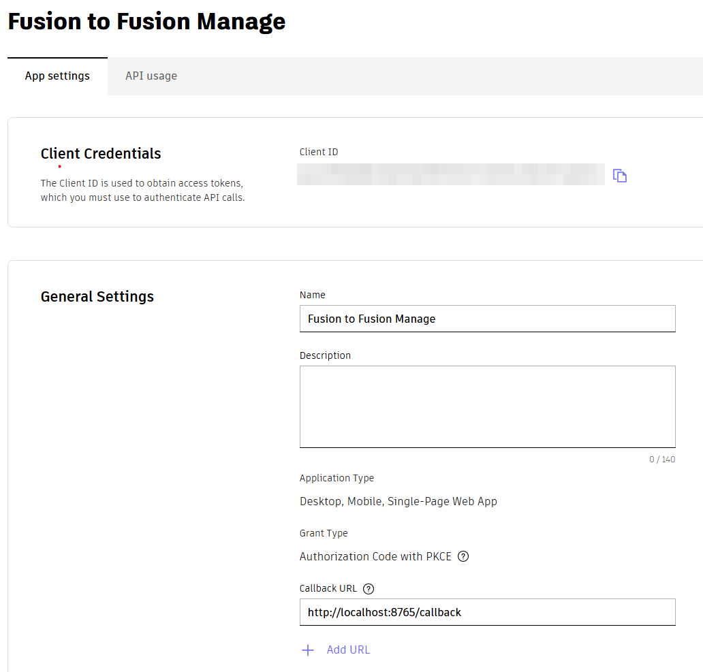
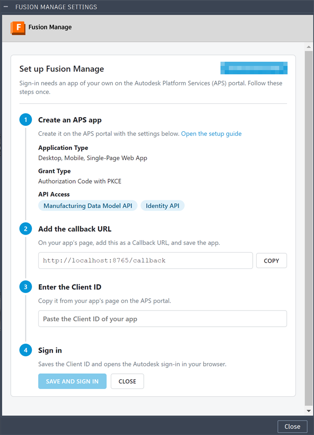
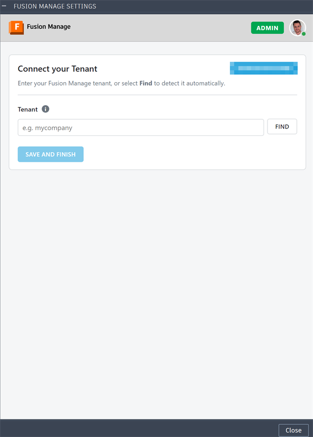
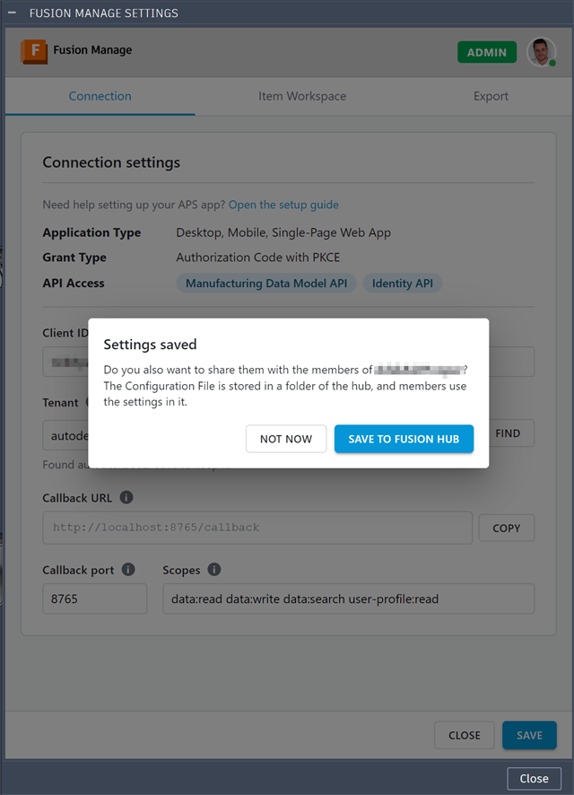
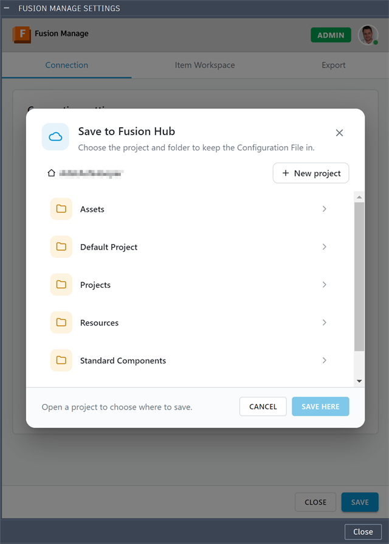
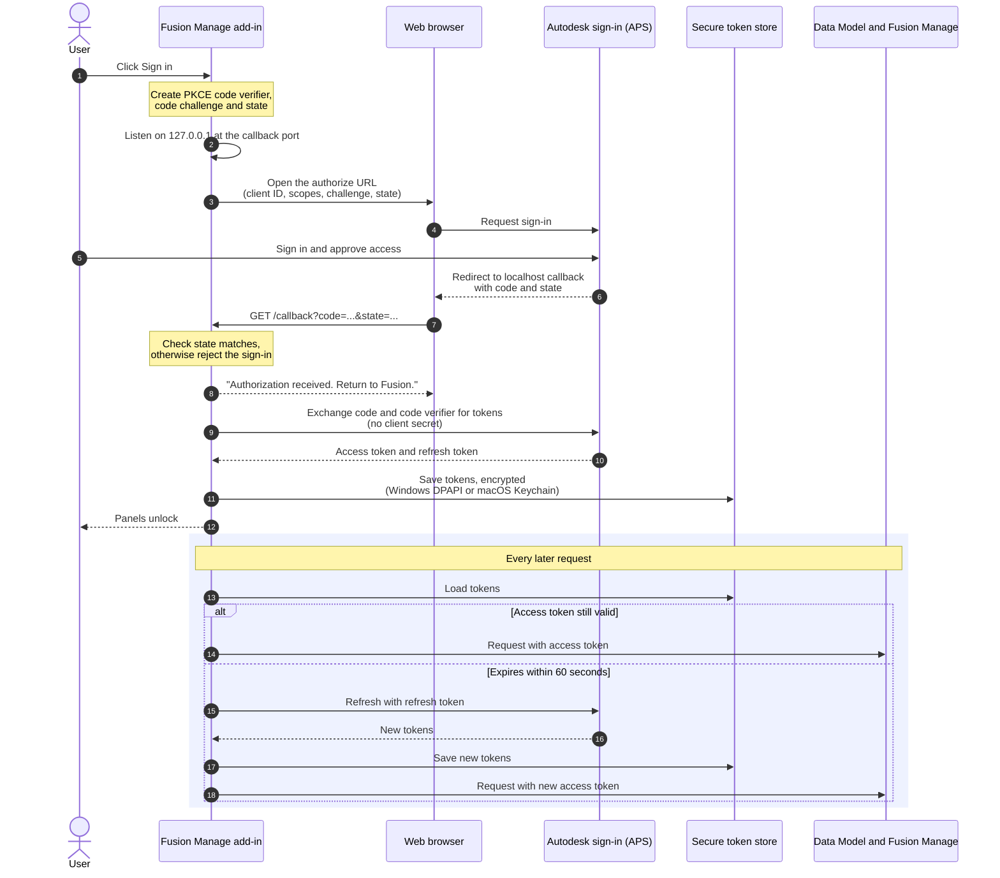

# Installation and Authentication

**What you'll do here:** install the add-in in Fusion and sign in to Fusion Manage. Allow about 15 minutes, plus time for an administrator if your organisation has no APS application yet.

## Quick steps

1. **Install:** download the latest release zip, unzip it, and add the folder in Fusion ([stage 1](#1-install-the-add-in)).
2. **Get a Client ID:** ask your administrator for the organisation's Client ID, or create an APS application yourself ([stage 2](#2-get-a-client-id)).
3. **Connect:** open **Preferences** and follow the setup wizard: add the callback URL, enter the Client ID and sign in (approve access in your browser), then enter your tenant ([stage 3](#3-configure-the-connection)).

| Stage | What you do | Who |
|---|---|---|
| [1. Install the add-in](#1-install-the-add-in) | Load the add-in into Fusion | Each user |
| [2. Get a Client ID](#2-get-a-client-id) | Obtain the **Client ID** that identifies the add-in | Once per organisation (or per developer) |
| [3. Configure the connection](#3-configure-the-connection) | Follow the setup wizard: Client ID, sign in, then tenant | Each user, or import a shared file |

---

## 1. Install the add-in

1. Download the latest zip from the [Releases page](https://github.com/AHoop91/FusionToFusionManageAddon/releases/latest) and unzip it. You get a folder named **Fusion Manage Item Management**, which holds `Fusion Manage Item Management.py` and `Fusion Manage Item Management.manifest`.
2. In Fusion open **Utilities ▸ Add-Ins ▸ Scripts and Add-Ins**, switch to the **Add-Ins** tab, click **+** (add existing add-in) and browse to the folder.
3. Select **Fusion Manage Item Management** in the list and click **Run**. Tick **Run on Startup** if you want it to load with Fusion.

The add-in supports Windows and macOS. Once it is running, an **Export** panel and an **Item Management** panel appear in the **Manage** tab of the Design and Drawing workspaces. Most buttons stay greyed out until setup is complete.

{ width="800" height="515" }

---

## 2. Get a Client ID

The add-in signs in through Autodesk Platform Services (APS), so it needs an APS application. The application's **Client ID** identifies the add-in when you sign in. This is done on the APS website, not in Fusion.

!!! info "You may already have one"
    If your organisation has already created an application for this add-in, ask for its **Client ID** and skip to [stage 3](#3-configure-the-connection). One application can be shared by everyone; each person still signs in with their own Autodesk account.

**What you need first:**

- An Autodesk account that can sign in at [aps.autodesk.com](https://aps.autodesk.com).
- An APS subscription (Free or Paid tier) assigned to a team.
- A **Team Administrator** to set up the APS Developer Hub, if your organisation does not have one yet. See [Administrator setup](#administrator-setup).

### 2.1 Create the application

{ width="668" height="615" }

1. Sign in at [aps.autodesk.com](https://aps.autodesk.com) and open **My Applications**.
2. Click **Create application**.
3. When asked for the application type, choose **Desktop, Mobile, Single-Page App**.

    !!! important "Choose this type"
        The add-in signs in with PKCE and never holds a client secret. This is the type APS recommends for applications that cannot protect their credentials. Do not choose **Traditional Web App** or **Server-to-Server App**.

4. Enter an application name and description, for example *Fusion Manage Add-in*.
5. Select the APIs the add-in uses: the **Manufacturing Data Model API** (to read designs) and the **Identity API** (for your profile picture). Select the matching entries your portal offers.
6. Set the **Callback URL** to exactly:

    ```
    http://localhost:8765/callback
    ```

    If you will use a different callback port in the add-in, use that port here instead. The two must match exactly.

7. Save the application.

!!! note "Labels can change"
    The APS portal is updated from time to time, so button names and field order may differ slightly from this list. The application type, the APIs and the callback URL are what matter.

### 2.2 Copy the Client ID

Open the application under **My Applications**. Its details page shows the **Client ID**, a 32-character string. Copy it. You will paste it into the add-in in the next stage.

{ width="1032" height="987" }

An application of this type has no client secret that you need. Never type one into the add-in.

### Administrator setup

??? note "Team Administrators only: APS subscription and Developer Hub"
    **A1. Get an APS subscription (Team Administrator)**

    Skip this if your organisation already has an APS offering assigned to a team.

    1. Go to [aps.autodesk.com](https://aps.autodesk.com) and sign in or sign up. Click **View options**.
    2. On the APS overview page, use the **Site Selector** (top right) to choose your country before signing in.
    3. Click **Pricing** in the left-hand menu, then **Add to Cart** under the offering you want, then **Checkout** and complete the customer details.
        - A **Free** plan is not charged, but checkout still asks for a payment method.
        - A **Paid** plan needs a valid payment method.
    4. Click **Access Account**, which opens the [Autodesk Account portal](https://manage.autodesk.com/home).
    5. If you administer more than one team, go to **Billing and Orders ▸ Subscriptions and Contracts** and confirm the APS offering is assigned to the right team.

    !!! note
        If your region is not offered in the Autodesk Store, contact `aps.orders@autodesk.com`.

    **A2. Create the APS Developer Hub (Team Administrator)**

    The Developer Hub is where your organisation's APS applications live, and where you control who can create them.

    1. Open [manage.autodesk.com](https://manage.autodesk.com/).
    2. Go to **Products and Services ▸ Hubs**.
    3. Choose the **team** the APS offering is assigned to.
    4. Click **Create Hub** and select **APS Developer Hub**.
    5. Enter a **Hub Name** and click **Create & Activate**.
    6. Under **Cloud Product**, click the **APS Developer Hub** link. This opens [aps.autodesk.com/hubs](https://aps.autodesk.com/hubs/).

    !!! warning "No “APS Developer Hub” option?"
        The team has no APS offering assigned to it. Complete step A1 first.

    **A3. Add developers to the hub (Team Administrator)**

    1. In the hub, open **Roles and Access**.
    2. Click **Add Member** and enter the person's **email address**.
    3. Choose an access level, **Admin** or **Developer**, and click **Add**.

    Anyone who needs to create the application must be a member of the hub.

    **A4. Moving an existing application into the hub**

    If you already created the application before your organisation had a Developer Hub, move it in:

    1. Sign in at [aps.autodesk.com](https://aps.autodesk.com) and open **My Applications**.
    2. Select the application.
    3. Click **Move apps to Developer Hub**.
    4. Select the hub name and click **Next**.

    You must already be a member of the hub (see A3).

    !!! tip "More reading"
        This section follows Autodesk's own guide, [APS Developer Hub Setup and App Migration](https://aps.autodesk.com/blog/aps-developer-hub-setup-and-app-migration), and the post [New application types](https://aps.autodesk.com/blog/new-application-types). Refer to them if your portal looks different.


---

## 3. Configure the connection

Open **Manage ▸ Item Management ▸ Administration ▸ Preferences**. Until a Client ID is saved, the panel shows a setup wizard instead of the sign-in card. It walks you through the connection in two parts: the app and Client ID, then your tenant.

### 3.1 Set up Fusion Manage

The first screen, **Set up Fusion Manage**, has four steps.

{ width="640" height="888" }

1. **Create an APS app.** If you have not done so, follow [stage 2](#2-get-a-client-id). The wizard lists the settings the app needs: **Desktop, Mobile, Single-Page Web App**, grant type **Authorization Code with PKCE**, and the **Manufacturing Data Model API** and **Identity API**. **Open the setup guide** opens Autodesk's guide to creating an app.
2. **Add the callback URL.** On your app's page in the APS portal, add the callback URL the wizard shows and save the app. **Copy** puts it on your clipboard. With the default port it is:

    ```
    http://localhost:8765/callback
    ```

3. **Enter the Client ID.** Paste the Client ID from [step 2.2](#22-copy-the-client-id).
4. **Sign in.** Click **Save and sign in**. The button stays disabled until a Client ID is entered. It saves the Client ID and opens the Autodesk sign-in in your browser. Approve access there and return to Fusion ([how sign-in works](#how-sign-in-works)).

### 3.2 Connect your tenant

Once you are signed in, a Hub Admin sees **Connect your Tenant**. It is required, and the tabs stay hidden until a tenant is saved.

{ width="640" height="894" }

!!! tip "Click Find to fill in the tenant automatically"
    Open a design linked to a Fusion Manage item, then click **Find**. The add-in reads the tenant from that item's address and fills in the field, so you do not have to type it.

    **Find only works when:**

    - You are signed in, because it reads the design through your Autodesk account.
    - A design is open in Fusion and is the active document. A drawing, or a document with no design, gives nothing to read.
    - The design is saved to your hub, so the Manufacturing Data Model knows it.
    - The design is linked to a Fusion Manage item. If it is not, the panel says so; open one that is, or enter the tenant yourself.

    It reads only the open design, and gives up if there is no answer after a minute.

Or enter the **Tenant** yourself:

1. Open Fusion Manage in your browser and look at the address bar. It looks like this:

    ```
    https://acme.autodeskplm360.net/plm/...
    ```

2. Copy only the first part of the host name, the bit before `.autodeskplm360.net`. Here that is `acme`. Do not copy `https://`, `.autodeskplm360.net` or anything after it.
3. Paste it into the **Tenant** field, so the field holds just `acme`.

The tenant can only be letters, digits and hyphens, never a whole address. The hub's name is not the tenant, so the add-in does not guess it.

Whichever way you filled it in, click **Save and finish** to keep it. **Find** only fills in the field; it does not save.

Anyone who is not a Hub Admin does not see this step. They are asked to find the hub's Configuration File instead ([below](#sharing-a-setup-with-colleagues)).

### 3.3 Change the connection later

After setup, the same settings are on the **Connection** tab of **Preferences**.

!!! important "Only a Hub Admin can change them"
    Settings belong to the Fusion hub that is active. When Preferences opens, the add-in checks your role in that hub, and checks again when you return to the panel. A **Hub Admin** can edit the Connection tab. Anyone else sees the fields greyed out, with the note "These settings come from the hub's Configuration File. Only a Hub Admin can change them." If the add-in cannot check your role, the tab is left usable, so a failed check does not lock out an admin.

To change a setting, as a Hub Admin:

1. Open **Preferences** and go to the **Connection** tab.
2. Edit the field. If you change the **Callback port**, the callback URL shown under it updates as you type.
3. Click **Save**. The settings are checked first, and a problem is shown instead of saving.
4. When the save passes, you are asked whether to share the settings with the hub. Choose **Save to Fusion Hub**, so your colleagues get the change ([how it works](#save-to-fusion-hub)).

Two changes need a follow-up:

- **Client ID:** sign-in is kept per Client ID, so after changing it you sign in again with the new one.
- **Callback port:** the callback URL on your APS app must match the new port, or sign-in fails.

| Setting | What it is |
|---|---|
| **Client ID** | The Client ID from [step 2.2](#22-copy-the-client-id). |
| **Callback port** | The port in your callback URL. Default `8765`; allowed range 1024–65535. If you change it, change the callback URL on your APS app to match. |
| **Scopes** | Leave as `data:read data:write data:search user-profile:read`. |
| **Tenant** | The tenant from [step 3.2](#32-connect-your-tenant). |

The tab shows the callback URL it will use. It must be registered on your APS application exactly as shown. A Client ID, a valid port and at least one scope are required before you can sign in.

### Save to Fusion Hub

Saving puts the settings on your own computer only. **Save to Fusion Hub** also stores them in the hub, as a Configuration File, so the other people in the hub can use the same setup without entering it themselves. Only a Hub Admin is offered it.

{ width="640" height="886" }

1. Click **Save**. Once the settings pass validation, the **Settings saved** dialog asks: "Do you also want to share them with the members of *your hub*?"
2. Click **Not now** to keep them on this computer only. Press **Esc** or click outside the dialog to do the same. You can share later by saving again.
3. Click **Save to Fusion Hub**. A **Save to Fusion Hub** window opens, showing the hub's projects and folders.
4. Open a project, then a folder in it, where the hub's members can read files. **New project** (at the top of the hub) and **New folder** (inside a project) make one if you need it.
5. Click **Save here**. The add-in uploads `Fusion-Manage-Item-Management-config.json` to that folder and tells you which folder it went to.

{ width="640" height="894" }

What to know:

- **It holds your setup, not your sign-in.** The file has the tenant, workspaces, field mappings and exports. It never holds sign-in tokens.
- **The upload uses your Fusion session.** It needs no extra permission, but you must be allowed to add files to the folder you pick. If not, the add-in says so.
- **It is for the active hub.** A file saved from one hub is refused by another.
- **Share again after a change.** Each share uploads the file again to the folder you choose. Choose the folder your colleagues already use, so they keep reading the same file.
- **Colleagues find it once.** A member who is not a Hub Admin is asked to **Find Configuration File** and picks the file in the hub. After that, their add-in reads it again each time Preferences opens, so a change you share reaches them without them doing anything.

### Sharing a setup with colleagues

Each Fusion hub has its own settings, so switching hubs in Fusion switches the settings too. Only a **Hub Admin** of the hub can change them. When you open **Preferences** the add-in checks your role in the active hub.

- **Hub Admin**: click **Save**. Once the settings pass validation and are saved on this computer, you are asked whether to share them: **Save to Fusion Hub** asks for a project and folder in the hub and stores the Configuration File there (`Fusion-Manage-Item-Management-config.json`). It never contains sign-in tokens.
- **Everyone else**: the add-in asks you to find the hub's Configuration File. Click **Find Configuration File**, pick the file in the hub, and its tenant, workspaces, field mappings and exports become your settings, read-only. You still sign in with your own Client ID. The file is read again each time Preferences opens.
- A file saved from another hub is refused, and files over 1 MB or that are not an MfgToFm configuration are rejected.

---

## How sign-in works

The wizard's **Save and sign in** button starts sign-in for you. Your browser opens the Autodesk sign-in page; sign in and approve access, and the browser shows **Authorization received**. Return to Fusion and the panel unlocks its tabs. Sign-in waits up to 180 seconds, and **Cancel** ends it sooner. Later, if you have signed out or your session has expired, **Sign in** on the Preferences panel does the same. To sign out, use the account menu in the panel header, which removes the stored tokens for the current Client ID.

This section explains what happens behind that. The add-in uses the OAuth 2.0 authorization-code flow with PKCE. Your password is only ever entered on the Autodesk sign-in page, never in Fusion or the add-in.



If sign-in is cancelled, rejected or times out after 180 seconds, nothing is stored. If a refresh fails, the stored tokens are cleared and you are asked to sign in again.

### How sign-in stays secure

- The add-in listens on `127.0.0.1` only, for that one redirect, and checks the `state` value to reject forged redirects.
- It uses PKCE and sends no client secret.
- Tokens are never written to the configuration file or to logs.

| Platform | Where tokens are stored |
|---|---|
| Windows | Encrypted with Windows DPAPI for your user account, in a file under `%LOCALAPPDATA%\MfgToFm`. |
| macOS | Your login Keychain. |

### Permissions in Fusion Manage

Signing in proves who you are. It does not give you access to anything in Fusion Manage. What you can do is decided by the permissions your Fusion Manage user holds in the **Items workspace**, which are set by your Fusion Manage administrator through your role. The add-in reads them from Fusion Manage each time it needs them, and never changes them.

!!! important "Ask your Fusion Manage administrator, not the add-in"
    If something is refused, the add-in cannot grant the permission. Send your administrator the permission names from the message, and ask for them on the Items workspace.

**What each task needs**

| Task | Permissions required in the Items workspace |
|---|---|
| Choose the Items workspace in Preferences | View Items, Add Items, Edit Items, View BOM, Add To BOM and Edit BOM |
| Publish a design as new and updated items, and their BOMs | The same six |
| Open an item in the Item Panel | View Items |
| Attach a STEP file or a drawing PDF | View Items, Add Attachments and Edit Attachments, in the workspace the file goes to (the Items workspace, or the Components workspace for a component) |

The first two rows ask for all six, whether or not a given publish adds or changes anything. This is because the BOM is always published. Within that, creating an item needs **Add Items**, updating one needs **Edit Items**, and BOM lines need **Add To BOM** and **Edit BOM**. See [Publishing](../publishing/index.md).

**Tabs in the Item Panel**

A tab you lack the permission for is greyed out, rather than hidden. Hover over it to see "Insufficient permissions".

| Tab | Permission |
|---|---|
| Item | View Items |
| Files | View Attachments |
| BOM | View BOM |
| Where Used | View Where Used |
| Workflows | View Associated Workflow |
| Changelog | View Change Log |

**If a permission is missing**

The message names what is missing, for example:

> Insufficient permissions to publish to the Items workspace. Missing: Add Items, Edit BOM.

In Preferences, choosing a workspace you lack permissions on says "You need these permissions on *workspace*: ...". If Fusion Manage refuses the check outright, the message says "Insufficient permissions" without a list. Either way, ask your administrator to add the permissions to your role, then try again.

### Next step

Continue to [Configuration](../configuration/index.md), where you choose the Items workspace, map fields to it and set where exported files are attached. To see what the add-in reads from your design first, read [Manufacturing Data Model](../reference/manufacturing-data-model.md).
