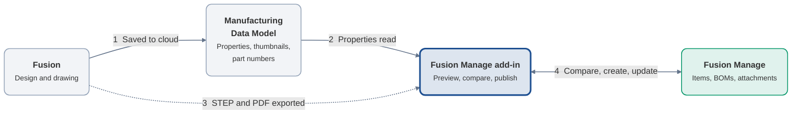
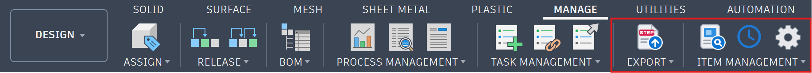

# Overview

**In one sentence:** the add-in copies a released design from Fusion into Fusion Manage, as a manufacturing item with its parts list (BOM) and files, when you tell it to.

Engineers keep working in Fusion. Manufacturing, purchasing and quality teams work from the item in Fusion Manage. Unfamiliar words are explained in the [Glossary](glossary.md).

## What you can do

- **Sign in** to Fusion Manage from Fusion with your Autodesk account ([Installation](installation.md)).
- **Choose which design properties fill which Fusion Manage fields** ([Configuration](../configuration/index.md)).
- **Create and update items** from a design, matched by item number ([Publishing](../publishing/index.md)).
- **Compare and synchronise the BOM** between the design and Fusion Manage ([Bill of Materials](../publishing/index.md#bill-of-materials)).
- **Attach a STEP file or drawing PDF** to an item, only when you choose to ([STEP File](../publishing/index.md#step-file), [Drawing Representation](../publishing/index.md#drawing-representation)).
- **Review an item inside Fusion**: fields, files, BOM, where-used and workflows ([Item Panel](../item-panel/index.md)).
- **Follow your publishes** and retry a failed one ([Job Queue](../job-queue/index.md)).

## Why it exists

Engineering and the enterprise work to different rhythms. Engineers iterate on designs, while manufacturing, purchasing, quality and supply chain teams need a stable, controlled record of what is to be built. Mixing the two forces one side to inherit the other's pace and permissions.

The add-in keeps them separate by design:

- **Engineering components** stay in Fusion, where design work continues and revisions are managed.
- **Manufactured items** live in Fusion Manage, each with its own lifecycle, approvals and release status.
- **The add-in is the controlled bridge between them.** Fusion and Fusion Manage each keep doing their own job, and information crosses only when you choose to publish.

The result is a single, traceable path from a released design to an item the enterprise can rely on, without re-keying data or maintaining parallel spreadsheets. The [End-to-End Workflow](workflow.md) shows how this works in practice.

## How it works

The add-in reads a design's components, properties, thumbnails and part numbers from the Manufacturing Data Model and compares them with what already exists in Fusion Manage. It shows you the differences before anything changes, then sends **only what needs to be created or updated**. Nothing is overwritten blindly, and you stay in control of every publish.

## How it fits together

The add-in takes what the design says in the Manufacturing Data Model, compares it with Fusion Manage, and sends only the difference.

| Step | What happens |
|---|---|
| **1** | Engineering saves the design. Fusion stores its components and properties in the Manufacturing Data Model. |
| **2** | The add-in reads each component's properties, thumbnail and part number from the Manufacturing Data Model. |
| **3** | When you attach a technical representation, the add-in has Fusion export a STEP file or a drawing PDF. |
| **4** | The add-in reads the matching items and BOMs in Fusion Manage, shows you the differences, and on your command creates or updates items, BOM lines and attachments. |

One sign-in covers both the Data Model and Fusion Manage. It is explained step by step in [Installation and Authentication](installation.md#how-sign-in-works).

Items are matched by **item number**, which the add-in takes from the component's part number. If an item with that number already exists in Fusion Manage it is updated; otherwise it is created.

## The user interface

The add-in adds an **Export** panel and an **Item Management** panel to the **Manage** tab of the ribbon in the **Design** and **Drawing** workspaces. **Administration** is a submenu of **Item Management**; its buttons are pinned to the ribbon.

| Panel | Button | Purpose |
|---|---|---|
| Export | Export | Open the Export window: export the open design or drawing and attach the file to its item or component |
| Item Management | Open Fusion Manage Item | Show the item of the selected component, or of the open design or drawing |
| Item Management | Publish Fusion Manage Item (Design only) | Preview and publish the open design |
| Item Management ▸ Administration | Job Queue | See publishes that are waiting, running and finished |
| Item Management ▸ Administration | Preferences | Sign in, set the connection and the workspace mapping |

Most buttons stay greyed out until the Items workspace is configured (see [Workspace and Field Mapping](../configuration/index.md#workspace-and-field-mapping)). The tooltip of a greyed-out button says why.

The same actions are available from the right-click menu of a component in the browser or canvas: **Open Fusion Manage Item**, **Publish Fusion Manage Item** (top-level component only), **Export STEP File** and, in a drawing, **Export PDF**.

!!! example "Screenshot placeholder: Right-click menu on a component"
    **Show:** The right-click menu of a component in the browser, showing the Fusion Manage entries.

    Save the image as `docs/images/context-menu.png`, then replace this box with ``.

## Requirements

- Autodesk Fusion on Windows or macOS.
- A Fusion Manage tenant and a user with permission to work in the target workspace.
- An Autodesk Platform Services (APS) application registered for sign-in (see [Installation and Authentication](installation.md)).

## Scope

The add-in works with a single Fusion Manage workspace, **Items**. See [Troubleshooting and Limitations](../reference/troubleshooting.md#limitations) for what is not yet supported. Get the latest version from the [Releases page](https://github.com/AHoop91/FusionToFusionManageAddon/releases/latest).

## Next step

[Install the add-in and sign in](installation.md).
