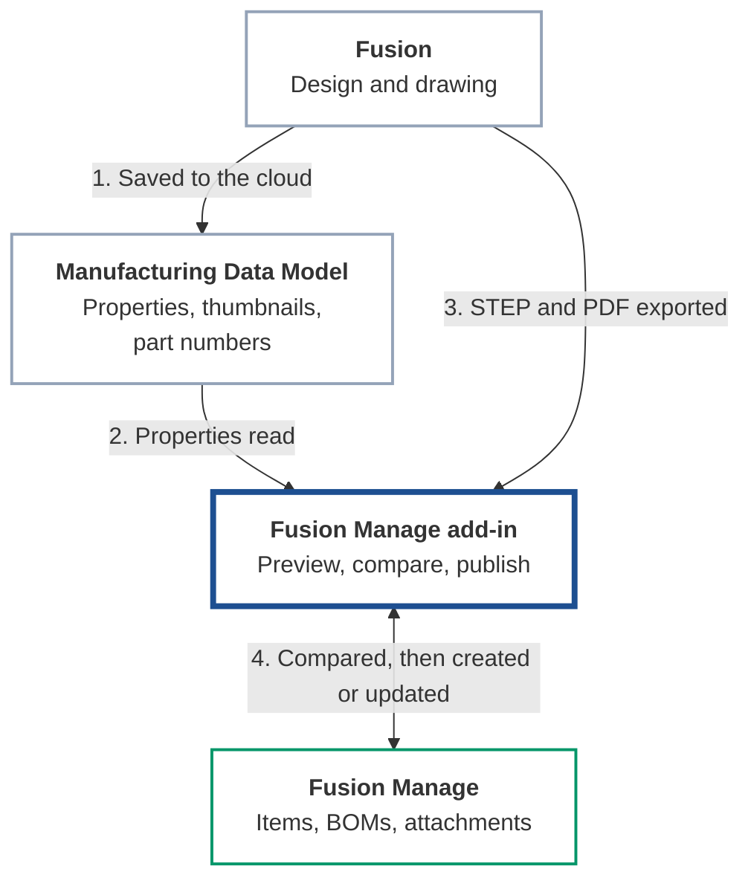

# Overview

This add-in is vault-inspired item management for Fusion, powered by Fusion Manage. It carries a **released engineering definition** from Fusion into **independently managed manufacturing items and BOMs** in Fusion Manage, with the representations and information the wider supply chain needs.

Engineering components and manufactured items are kept separate, so each has its own lifecycle. The add-in is the bridge between them. Fusion and Fusion Manage keep doing their own jobs. See the [End-to-End Workflow](workflow.md) for how this works in practice.

Technically, it reads the design's components, properties and thumbnails from the Manufacturing Data Model, compares them with what already exists in Fusion Manage, and sends only what needs to be created or changed.

## What it does

| Capability | Where to read more |
|---|---|
| Sign in to Fusion Manage from Fusion using your Autodesk account | [Installation and Authentication](installation.md) |
| Read components, properties and BOMs from the Manufacturing Data Model | [Manufacturing Data Model](../configuration/index.md#manufacturing-data-model) |
| Map those properties to Fusion Manage fields | [Workspace and Field Mapping](../configuration/index.md#workspace-and-field-mapping) |
| Create and update items in a Fusion Manage workspace | [Publishing](../publishing/index.md) |
| Compare and synchronise the design BOM with the Fusion Manage BOM | [Bill of Materials](../publishing/index.md#bill-of-materials) |
| Attach a STEP file or a drawing PDF to an item, manually and only when you choose to | [STEP File](../publishing/index.md#step-file), [Drawing Representation](../publishing/index.md#drawing-representation) |
| Browse an item's fields, files, BOM, where-used and workflows inside Fusion | [Item Panel](../item-panel/index.md) |
| Follow publishes that are waiting, running and finished, and retry a failed one | [Job Queue](../job-queue/index.md) |

To see how these fit together in practice, from engineering release through to release in Fusion Manage, read the [End-to-End Workflow](workflow.md).

## How it fits together

The add-in takes what the design says in the Manufacturing Data Model, compares it with Fusion Manage, and sends only the difference.

| Step | What happens |
|---|---|
| **1** | Engineering saves the design. Fusion stores its components and properties in the Manufacturing Data Model. |
| **2** | The add-in reads each component's properties, thumbnail and part number from the Manufacturing Data Model. |
| **3** | When you attach a technical representation, the add-in has Fusion export a STEP file or a drawing PDF. |
| **4** | The add-in reads the matching items and BOMs in Fusion Manage, shows you the differences, and on your command creates or updates items, BOM lines and attachments. |

One sign-in covers both the Data Model and Fusion Manage. It is explained step by step in [Installation and Authentication](installation.md#how-sign-in-works).

Items are matched by **item number**, which the add-in takes from the component's part number. If an item with that number already exists in Fusion Manage it is updated; otherwise it is created.

## The user interface

The add-in adds a **Fusion Manage** tab to the ribbon in the **Design** and **Drawing** workspaces.

| Panel | Button | Purpose |
|---|---|---|
| Item | Open Fusion Manage Item | Show the Fusion Manage item of the selected component, or of the open design or drawing. |
| Item | Publish Fusion Manage Item (Design only) | Preview and publish the open design. |
| Item | Upload Drawing Representation To Fusion Manage Item (Drawing only) | Attach a PDF of the open drawing. |
| Administration | Job Queue | See publishes that are waiting, running and finished. |
| Administration | Preferences | Sign in, set the connection and the workspace mapping. |

Most buttons stay greyed out until the Items workspace is configured (see [Workspace and Field Mapping](../configuration/index.md#workspace-and-field-mapping)). The tooltip of a greyed-out button says why.

!!! example "Screenshot placeholder: Fusion Manage ribbon tab in the Design workspace"
    **Show:** The Fusion Manage tab with the Item and Administration panels and their buttons.

    Save the image as `docs/images/ribbon-design.png`, then replace this box with ``.

The same actions are available from the right-click menu of a component in the browser or canvas: **Open Fusion Manage Item**, **Publish Fusion Manage Item** (top-level component only), **Upload STEP File To Fusion Manage Item** and, in a drawing, **Upload Drawing Representation To Fusion Manage Item**.

!!! example "Screenshot placeholder: Right-click menu on a component"
    **Show:** The right-click menu of a component in the browser, showing the Fusion Manage entries.

    Save the image as `docs/images/context-menu.png`, then replace this box with ``.

## Requirements

- Autodesk Fusion on Windows or macOS.
- A Fusion Manage tenant and a user with permission to work in the target workspace.
- An Autodesk Platform Services (APS) application registered for sign-in (see [Installation and Authentication](installation.md)).

## Scope of this release

This is version 0.1.0. It works with a single Fusion Manage workspace, **Items**. See [Troubleshooting and Limitations](../reference/troubleshooting.md) for what is not yet supported.
