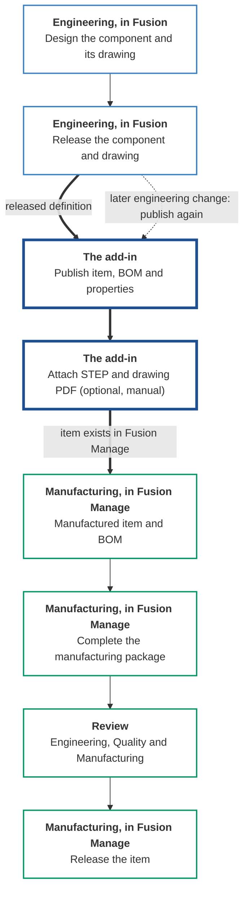

# End-to-End Workflow

## What the add-in is for

Engineering and manufacturing work on the same product, but they do not manage it the same way. Engineers define the product in CAD. Manufacturing, purchasing and the wider supply chain need a managed **item**, a bill of materials, and the documents and representations to build or buy it. Those need their own approvals, their own revisions and their own timing.

This add-in carries a **released engineering definition** from Fusion into **independently managed manufacturing items and BOMs** in Fusion Manage, together with the representations and information the wider supply chain needs. It is inspired by the item management of Autodesk Vault: the engineering file and the manufactured item are separate things, linked by a part number, each with a life of its own. Here that item management is provided by Fusion Manage.

**Fusion and Fusion Manage each keep doing their own job.** The add-in is only the bridge between them.

| | Fusion | The add-in | Fusion Manage |
|---|---|---|---|
| **Role** | Engineering definition | Bridge | Manufacturing item and BOM management |
| **Owns** | The CAD component, the drawing, and their engineering release | Nothing. It carries and compares | The manufactured item, its BOM, its lifecycle and its workflows |
| **Lifecycle** | Engineering lifecycle | None | Manufacturing lifecycle |

## Two lifecycles, kept separate

A released component and a manufactured item are not the same thing, so they are not forced to move together.

- Engineering can revise a component without the manufactured item changing until Manufacturing chooses to publish.
- Manufacturing can add to the item, for example extra BOM lines or fields that only make sense for production, without touching the CAD design.
- The item is released in Fusion Manage through its own workflow, on its own schedule.

Linking the two is the **part number**. A component's part number in Fusion is the item number in Fusion Manage. If an item with that number exists it is updated; otherwise it is created.

## The five stages

| Stage | Who | Where | What happens |
|---|---|---|---|
| [1. Engineering releases the component](#1-engineering-releases-the-component-and-drawing) | Engineering | Fusion | Normal release. Nothing changes for engineers. |
| [2. Manufacturing publishes the item](#2-manufacturing-publishes-the-enterprise-item) | Design Engineer or Manufacturing Engineer | Fusion, using the add-in | Released definition becomes manufacturing items and BOMs. |
| [3. Complete the manufacturing package](#3-complete-the-manufacturing-package) | Manufacturing | Fusion and Fusion Manage | Representations are attached and the BOM is completed. |
| [4. Review](#4-engineering-quality-and-manufacturing-review) | Engineering, Quality, Manufacturing | Fusion or Fusion Manage | Each group checks the item against the design. |
| [5. Release the item](#5-the-enterprise-item-is-released-in-fusion-manage) | Release approvers | Fusion Manage | The item is released through its own workflow. |

!!! note "The add-in does not enforce this process"
    It will publish any design you open, whatever its state, and it does not release items or start workflows. The sequence below is how it is meant to be used. Your organisation's own release rules still apply.

## Before you start

One-time setup:

- The add-in is installed and you are signed in ([Installation and Authentication](installation.md)).
- The Items workspace is configured, with field mappings and a match key ([Workspace and Field Mapping](../configuration/field-mapping.md)).
- Every user who publishes holds the Fusion Manage permissions listed in [Installation and Authentication](installation.md#permissions-in-fusion-manage).

---

## 1. Engineering releases the component and drawing

**Who:** Engineering, the designers who do the CAD work. **Where:** Fusion.

Engineers model the component, create its drawing, and release both **exactly as they normally would**. The add-in asks nothing more of them, and does not take part in this step.

What the next stage depends on:

- The design and drawing are saved and released.
- The Manufacturing Data Model has finished processing the design.
- Every component that should become an item has a **part number**, including the top-level one.
- The drawing references the released design.

!!! tip "Engineers are not blocked"
    Because the manufactured item has its own lifecycle, engineers release and revise in Fusion without waiting on Fusion Manage. The item is published when the Design Engineer or Manufacturing Engineer is ready.

## 2. Manufacturing publishes the enterprise item

**Who:** the Design Engineer or the Manufacturing Engineer. **Where:** Fusion. **Add-in:** Publish Fusion Manage Item.

This is the step that crosses the bridge. Either role can publish: the Design Engineer who released the component, or the Manufacturing Engineer who takes it on. It needs the Fusion Manage permissions listed under [Before you start](#before-you-start), so whoever publishes must hold them.

1. Open the released design.
2. Choose **Fusion Manage ▸ Item ▸ Publish Fusion Manage Item**.
3. Review the BOM and each component's properties in the Details Panel. Anything marked **New** or **Update** will change in Fusion Manage.
4. Click **Publish**.

The add-in creates an item for each component that does not have one, updates those that do, and synchronises the BOMs. Progress is shown in the **Job Queue**.

What crosses, and what does not:

| Crosses from engineering to the item | Stays independent |
|---|---|
| The properties you have mapped (part number, name, description, material, custom and physical properties) | Fields you have not mapped, which the add-in never overwrites |
| The thumbnail | The item's lifecycle state and workflow, which Fusion Manage owns |
| | STEP files and drawing PDFs, which are never sent by a publish. You upload them yourself in [stage 3](#3-complete-the-manufacturing-package) |
| The design's BOM structure and quantities | BOM lines that only Fusion Manage has, which are **kept** unless you choose to remove them |

!!! tip "Keep engineering and manufacturing state separate"
    Mapping Fusion's **Revision** or **Lifecycle state** is optional. If you do, map them to informational fields, for example a text field recording the engineering revision, and not to the field that drives the item's own lifecycle. Otherwise the two lifecycles are tied together again.

For the full procedure see [Publishing](../publishing/index.md) and [Bill of Materials](../publishing/index.md#bill-of-materials).

**Outcome:** every component exists as a manufacturing item in the Items workspace, with its properties, thumbnail and BOM.

## 3. Complete the manufacturing package

**Who:** Manufacturing. **Where:** Fusion and Fusion Manage.

The published item is the foundation. This stage adds what the supply chain needs to make or buy it.

!!! important "Representations are never added automatically"
    Publishing an item does **not** attach a STEP file, a drawing PDF or any other representation. Each one is uploaded manually, one at a time, from a menu command. You decide which representations go to the supply chain, for which items, and when. If you never upload one, none is sent.

| Task | How |
|---|---|
| Attach a STEP file of a component | Select the component and choose **Upload STEP File To Fusion Manage Item** ([STEP File](../publishing/index.md#step-file)). |
| Attach a PDF of the drawing | Open the drawing and choose **Upload Drawing Representation To Fusion Manage Item** ([Drawing Representation](../publishing/index.md#drawing-representation)). |
| Add items that are not in the design | Use **Add Items** in the Publish panel, then publish again ([Bill of Materials](../publishing/index.md#add-items)). |
| Keep or change manufacturing lines that only Fusion Manage has | Review the **Fusion Manage Only** lines. They are kept unless you remove them. |
| Complete information that engineering does not supply | Edit it in Fusion Manage. |

The drawing is not an item of its own. Its PDF is attached to the item of the design it shows. Uploading a file that is already attached creates a **new version**, so the package can be refreshed as the design changes.

!!! tip "When engineering changes the design later"
    Publish again. Items that already match are left alone, only the differences are sent, and what Manufacturing added in Fusion Manage is kept. Repeating a publish is safe.

**Outcome:** each item carries its STEP file, its drawing PDF and a complete BOM.

## 4. Engineering, Quality and Manufacturing review

**Who:** Engineering, Quality and Manufacturing. **Where:** Fusion, or Fusion Manage in a browser.

Each group checks the item against the design. In Fusion, open the **Item panel** (**Open Fusion Manage Item**) on the component. Anyone without the add-in, or who prefers the web, can review the same item in Fusion Manage directly.

| Review | Look at |
|---|---|
| Engineering: does the item match the design and drawing? | **Item** tab fields against the design's properties; **Bill of Materials** tab against the design BOM. |
| Quality: is the documentation present? | **Files** tab for the STEP file and drawing PDF. **Item** tab for the recorded revision. |
| Manufacturing: is the package complete? | **Bill of Materials** tab, including the manufacturing lines; **Where Used** for the assemblies that hold the item. |
| Everyone: is anything already in flight? | **Associated Workflows** tab for change orders that reference the item and their current state. |

See [Item Panel Tabs](../item-panel/tabs.md) for what each tab shows, and [Review and Release](../item-panel/review-and-release.md) for the routine.

If the review finds a problem, correct it at its source. A design problem is fixed in Fusion, released, and published again. A manufacturing problem is fixed in Fusion Manage. Then review again.

**Outcome:** the item is agreed to be correct and complete.

## 5. The enterprise item is released in Fusion Manage

**Who:** Release approvers. **Where:** Fusion Manage.

The manufactured item is released through **its own workflow in Fusion Manage**, independent of the engineering release in Fusion. The add-in does not move an item through its workflow.

1. In the Item panel, click **Open in browser** to go straight to the item.
2. In Fusion Manage, run the workflow action your organisation uses to release the item.
3. Back in Fusion, click **Refresh** in the Item panel to see the new state, or check the **Associated Workflows** tab for the workflow's progress.

**Outcome:** the manufactured item is released and available to the wider supply chain.

---

## Quick reference

| I want to… | Use |
|---|---|
| Create or update items from a released design | **Publish Fusion Manage Item** |
| See whether a publish succeeded | **Job Queue** |
| Retry after a failure | **Send to Fusion Manage** in the Job Queue |
| Attach a STEP file | **Upload STEP File To Fusion Manage Item** |
| Attach a drawing PDF | **Upload Drawing Representation To Fusion Manage Item** |
| Review an item | **Open Fusion Manage Item** |
| Release an item | Fusion Manage, via **Open in browser** |
