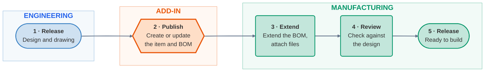

# End-to-End Workflow

## Overview

### The problem it solves

Engineering and manufacturing both work on the same product, but they work in different ways.

- **Engineers** change designs often. They try ideas, revise parts and release new versions.
- **Manufacturing** needs a steady record of what to build. It cannot build from a design that may change tomorrow.

When both teams share one record, each is slowed down by the other. Engineers wait on manufacturing approvals, or manufacturing builds from something that has moved on.

### The solution: two separate records

The add-in keeps the two apart and joins them only when someone chooses to.

| | **Engineering** | **Manufacturing** |
|---|---|---|
| **Lives in** | Fusion | Fusion Manage |
| **Record** | The design: component and drawing | The item: a manufacturing record with its own BOM |
| **Owned by** | Engineers | Manufacturing |
| **Responsible for** | Design changes and the design's own lifecycle | Saying "we are ready to build this now" |

**Engineering** is only responsible for the design and its lifecycle. Engineers design, revise and release in Fusion, and nobody waits on them.

**Manufacturing** takes a released design and creates an item from it. The item is Manufacturing's signal that *we are ready to build this now*. Manufacturing can then extend the item's bill of materials (BOM) with what production needs, such as packaging, fasteners and consumables, and release it through its own workflow.

The add-in is the bridge. A part number in Fusion becomes the item number in Fusion Manage. If an item with that number exists it is updated. Otherwise it is created.

### The benefits

- **Engineers are never blocked.** They release and revise without waiting for Manufacturing.
- **Manufacturing builds from a stable record.** The item changes only when someone publishes, so it does not move under them.
- **Each side keeps its own lifecycle.** A design revision does not force an item revision, and the reverse.
- **The BOM can be extended.** Manufacturing adds lines the design does not have, and a later publish keeps them.
- **No re-keying.** Data moves across, not through spreadsheets or copy and paste.
- **Safe to repeat.** Publishing again sends only the differences, so you can bring the item up to date at any time.
- **Ready for the wider business.** A released manufacturing item is the right starting point to pass to ERP for work orders, and then to selling. This add-in does not connect to ERP today. It makes the item that a future connection would use.

!!! note "The add-in does not enforce this process"
    It will publish any design you open, whatever its state, and it does not release items or start workflows. This is how it is meant to be used. Your organisation's own release rules still apply.

## The flow at a glance

Read the diagram left to right. Engineering releases a design in Fusion. The add-in publishes it to Fusion Manage. Manufacturing completes, reviews and releases the item.

| Stage | Who | Where |
|---|---|---|
| [1. Engineering releases the design](#1-engineering-releases-the-design) | Engineering | Fusion |
| [2. Publish the item](#2-publish-the-item) | Design or Manufacturing Engineer | Fusion, with the add-in |
| [3. Extend the manufacturing item](#3-extend-the-manufacturing-item) | Manufacturing | Fusion and Fusion Manage |
| [4. Review](#4-review) | Engineering, Quality, Manufacturing | Fusion or Fusion Manage |
| [5. Manufacturing releases the item](#5-manufacturing-releases-the-item) | Release approvers | Fusion Manage |

## Before you start

- The add-in is installed and you are signed in ([Installation and Authentication](installation.md)).
- The Items workspace is configured ([Configuration](../configuration/index.md#workspace-and-field-mapping)).
- Whoever publishes holds the [Fusion Manage permissions](installation.md#permissions-in-fusion-manage).

---

## 1. Engineering releases the design

**Who:** Engineering. **Where:** Fusion.

Engineers model the component, make the drawing and release both as they always do. The add-in is not involved and asks nothing more of them.

Before the next stage, check that:

- The design and drawing are saved and released.
- Every component that should become an item has a **part number**, including the top-level one.

**Outcome:** a released design that is ready to publish.

## 2. Publish the item

**Who:** the Design Engineer or the Manufacturing Engineer. **Where:** Fusion.

This is the step that crosses from engineering to manufacturing.

1. Open the released design.
2. Choose **Manage ▸ Item Management ▸ Publish Fusion Manage Item**.
3. Check the BOM. Anything marked **New** or **Update** will change in Fusion Manage.
4. Click **Publish**, and follow it in the **Job Queue**.

| Sent to the item | Not sent |
|---|---|
| The properties you have mapped, and the thumbnail | Fields you have not mapped |
| The design's BOM structure and quantities | STEP files and drawing PDFs (you upload these in stage 3) |
| | The item's lifecycle and workflow, which Fusion Manage owns |

!!! tip "Keep the two lifecycles apart"
    You can map Fusion's **Revision** or **Lifecycle state**. If you do, map them to informational fields, such as a text field for the engineering revision. Do not map them to the field that drives the item's own lifecycle.

Full steps are in [Publishing](../publishing/index.md).

**Outcome:** each component is an item in Fusion Manage, with its properties, thumbnail and BOM.

## 3. Extend the manufacturing item

**Who:** Manufacturing. **Where:** Fusion and Fusion Manage.

The published item is the starting point. Manufacturing now adds what it needs to build the product.

| Task | How |
|---|---|
| Extend the BOM with items that are not in the design | Use **Add Existing Items**, then publish again ([Bill of Materials](../publishing/index.md#add-existing-items)). |
| Keep or remove lines that only Fusion Manage has | Review the **Fusion Manage Only** lines. They are kept unless you remove them. |
| Attach a STEP file | Select the component and choose **Export STEP File** ([STEP File](../publishing/index.md#step-file)). |
| Attach a drawing PDF | Open the drawing and choose **Export PDF** ([Drawing Representation](../publishing/index.md#drawing-representation)). |
| Add information that engineering does not supply | Edit it in Fusion Manage. |

!!! important "Files are never added automatically"
    A publish does not attach a STEP file or a PDF. You choose which files go to the supply chain, for which items, and when. Uploading a file that is already attached creates a new version.

**Outcome:** the item has a complete BOM and the files manufacturing needs.

## 4. Review

**Who:** Engineering, Quality and Manufacturing. **Where:** Fusion or Fusion Manage.

Each group checks the item against the design. In Fusion, select the component and choose **Open Fusion Manage Item**. Anyone without the add-in can review the same item in Fusion Manage.

| Group | Check |
|---|---|
| Engineering | The **Item** tab and **Bill of Materials** tab match the design. |
| Quality | The **Files** tab has the STEP file and drawing PDF. |
| Manufacturing | The BOM is complete, and **Where Used** shows the assemblies that hold the item. |
| Everyone | **Associated Workflows** shows any change orders in progress. |

See [Item Panel](../item-panel/index.md#tabs) for what each tab shows.

If you find a problem, fix it where it starts. A design problem is fixed in Fusion, released and published again. A manufacturing problem is fixed in Fusion Manage.

**Outcome:** everyone agrees the item is correct and complete.

## 5. Manufacturing releases the item

**Who:** Release approvers. **Where:** Fusion Manage.

Releasing the item is Manufacturing's statement that **we are ready to build this now**. It is done through the item's own workflow in Fusion Manage, separate from the engineering release. The add-in does not move an item through its workflow.

1. In the Item panel, click **Open in browser**.
2. In Fusion Manage, run the workflow action your organisation uses to release the item.
3. Back in Fusion, click **Refresh** in the Item panel to see the new state.

**Outcome:** the item is released. A released item is the record that can later pass to ERP for work orders and sales.

## When the design changes

Engineering can keep revising after the item is released, and the item does not change until someone publishes. When Manufacturing needs it brought up to date, **publish again**. Items that already match are left alone, only the differences are sent, and what Manufacturing added in Fusion Manage is kept.

## Quick reference

| I want to… | Use |
|---|---|
| Create or update items from a released design | **Publish Fusion Manage Item** |
| See whether a publish worked | **Job Queue** |
| Retry after a failure | **Retry** in the Job Queue |
| Attach a STEP file | **Export STEP File** |
| Attach a drawing PDF | **Export PDF** |
| Review an item | **Open Fusion Manage Item** |
| Release an item | Fusion Manage, through **Open in browser** |
