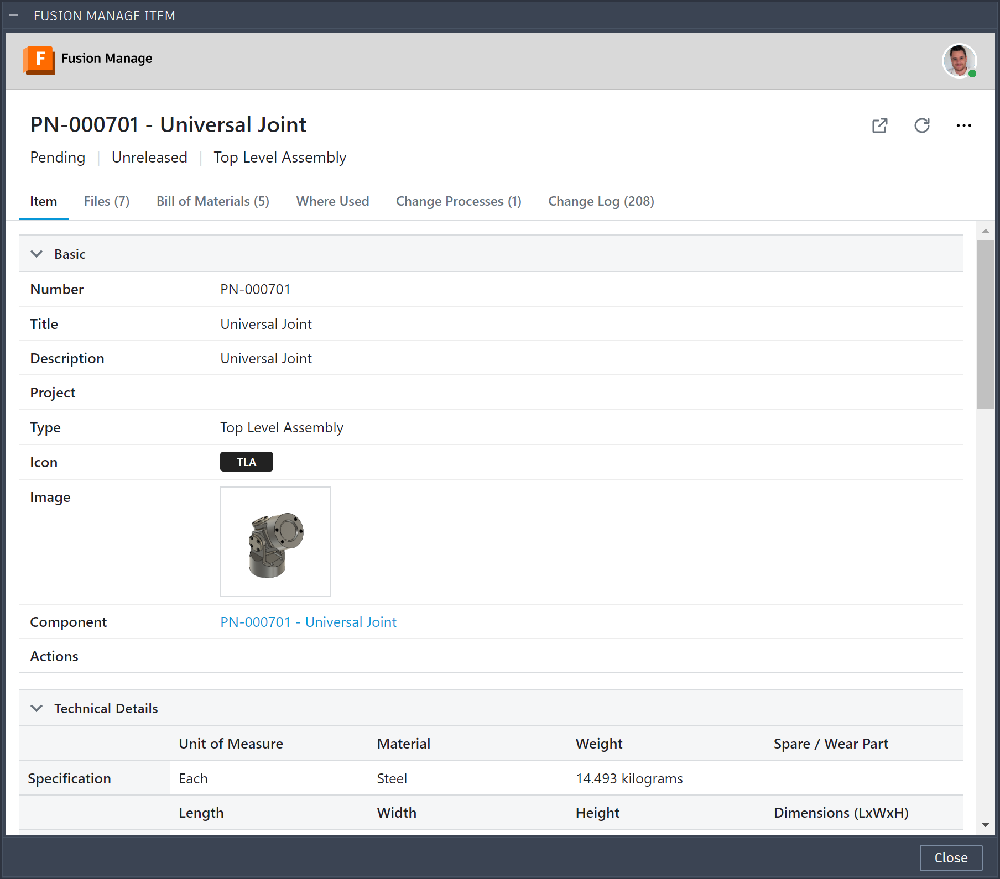
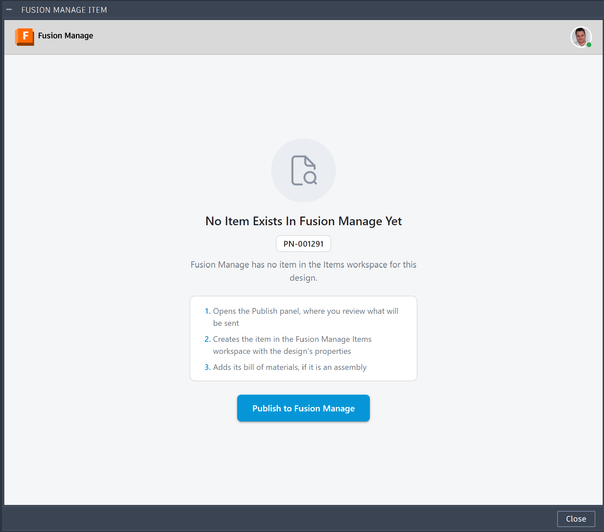
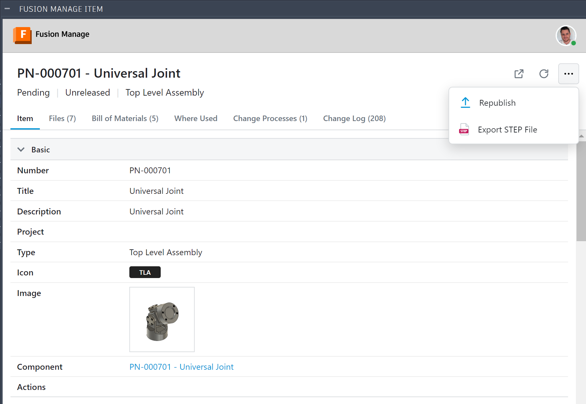
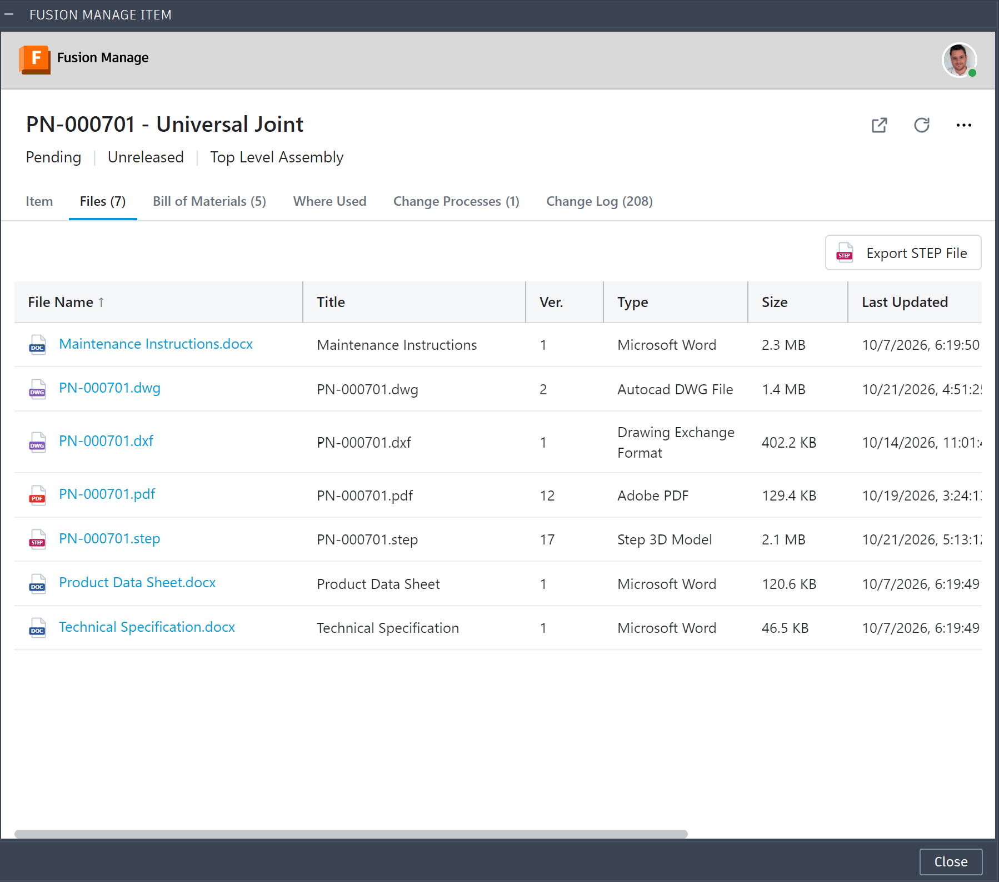
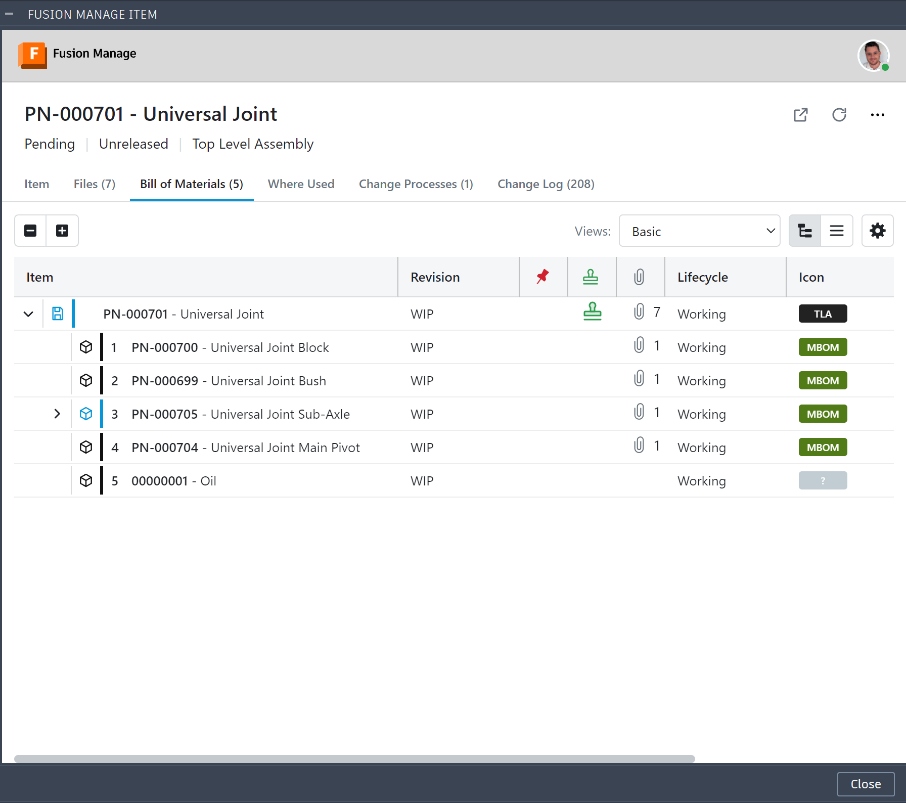
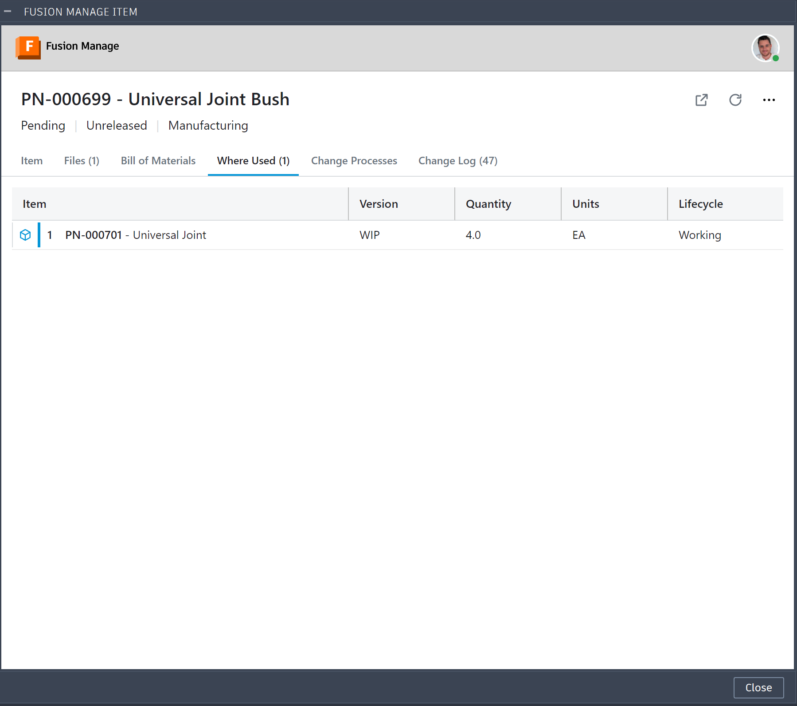
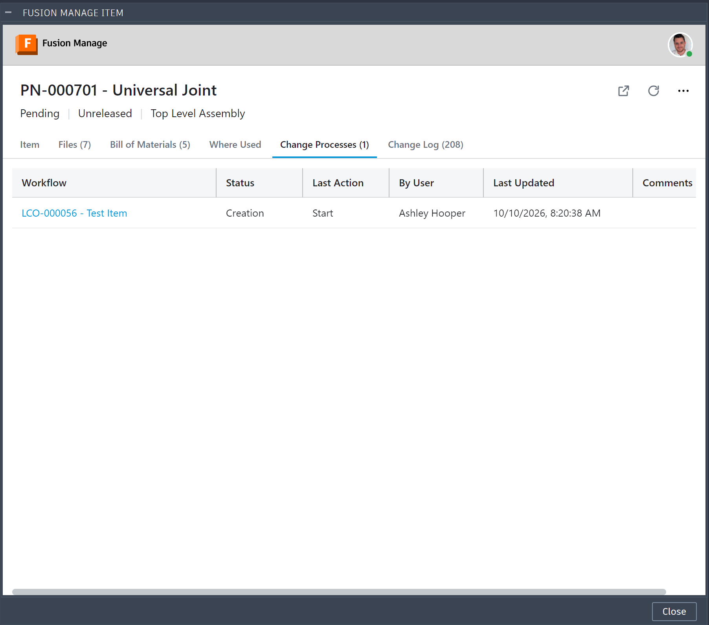
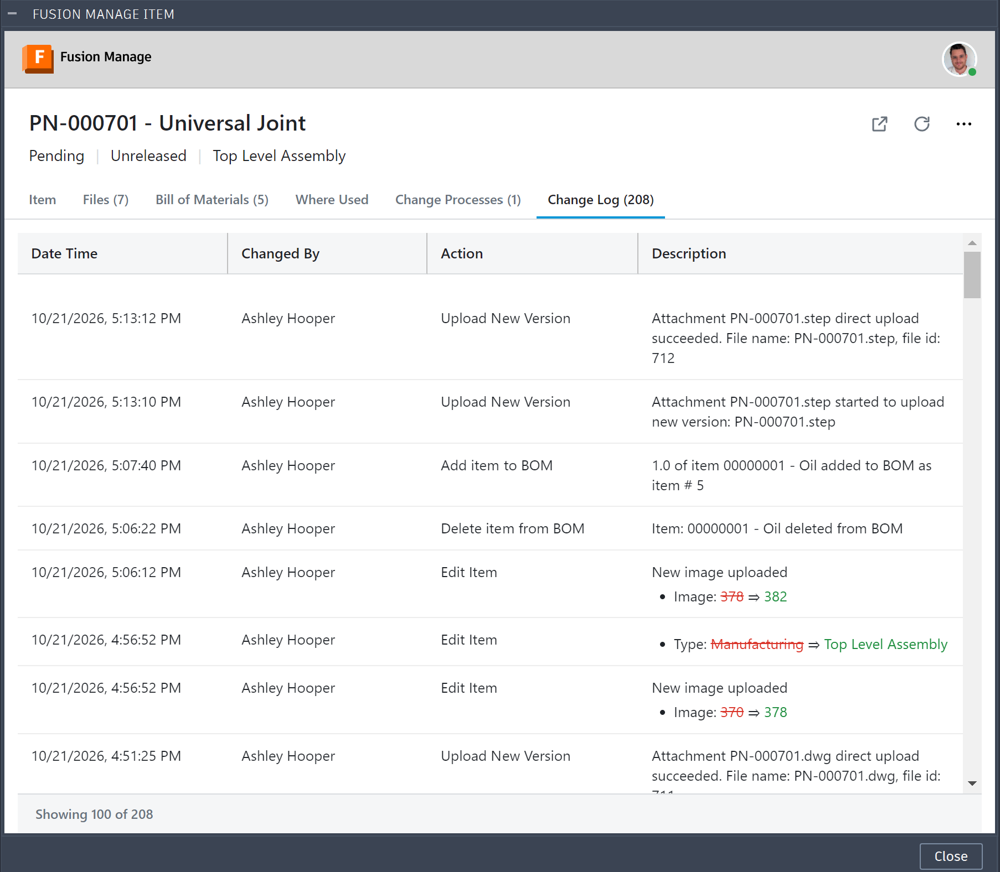

# Item Panel

**What you'll do here:** check an item's Fusion Manage record without leaving Fusion.

The **Item Panel** shows an item's Fusion Manage record inside Fusion, next to the design it came from. You can check a publish and see where an item stands in its lifecycle without switching to the browser.

**Quick steps:** select a component, choose **Manage ▸ Item Management ▸ Open Fusion Manage Item**, then use the [tabs](#tabs) to check fields, files, BOM, where-used and workflows.

!!! note "It is for reviewing"
    The panel reads the item. It does not move it through its workflow, and its only change to the item is attaching files you choose to upload. Release happens in Fusion Manage. See [Review and Release](#review-and-release).

## Open the Item Panel

- Select a component and choose **Manage ▸ Item Management ▸ Open Fusion Manage Item**, or right-click the component and choose **Open Fusion Manage Item**.
- With nothing selected, the panel shows the item of the open design (or, in a drawing, of the design the drawing shows).

The add-in finds the component you selected by its part number in the open design, reads that component's item number from the Manufacturing Data Model, and looks the item up in the Items workspace by that item number. The panel is drawn by the add-in from the item's own sections and fields, so it needs no separate web sign-in.

**The panel follows your selection.** While it is open, selecting another component shows that component's item.

{ width="700" }

If no item has the number, the panel says **No Item Exists In Fusion Manage Yet**, shows the item number, and lists what publishing will do: open the Publish panel to review what will be sent, create the item in the Items workspace with the design's properties, and add its bill of materials if it is an assembly. Click **Publish to Fusion Manage** to open the [Publish panel](../publishing/index.md). If you may not view the workspace, it tells you so.

{ width="700" }

### When several items share the number

If more than one item in the Items workspace has the component's item number, the panel does not guess. In place of the item it lists them, each with its descriptor and Item ID. Click the one you mean.

- Your choice is remembered for that item number until Fusion closes. It also decides which item a STEP file or drawing is attached to from the panel.
- A button that appears in the header (two arrows) shows the list again, so you can choose another.
- If the Fusion Manage search returns look-alike descriptors (`PN-1001 - A` and `PN-10010 - B` for `PN-1001`), the one whose descriptor starts with exactly the item number is used, and you are not asked.
- Better, give every item its own number. Two items with one number are a data problem in Fusion Manage, and publishing skips such a component until you choose.

## Header

{ width="700" }

| Control | What it does |
|---|---|
| Title and status line | The item's title, and a line with its version, lifecycle state and Type. |
| **Up-to-date check** (at the right end of the tabs) | A small circle turns while the panel compares the item's mapped fields with the open design, the same comparison the Publish panel makes. When all is well it disappears; when something differs it becomes an amber **OUT OF DATE** pill, and a red **CHECK FAILED** pill if the check could not be made. Click the pill to open a dialog that lists what differs (each field with what the open design holds beside what Fusion Manage holds, or each component with its two quantities) and has a **Republish** button that opens the Publish panel; for a failed check it gives the reason. Hover the pill for a short summary. The mark belongs to the tab shown, and the Item and Bill of Materials tabs have a check so far: the other tabs show no mark. (The Files tab marks out-of-date files on their own rows instead; see [Files](#files).) It is checked once each time the item is read in full (opening it, **Refresh**, an upload), not when you click the Item tab again. It is not shown for a component below the top of the design. |
| **Open in browser** | Opens the item in Fusion Manage in your web browser. |
| **Choose another item** | Shown only when several items share the number. Lists them again so you can pick a different one. |
| **Refresh** | Reads the item again from Fusion Manage. |
| **Actions** (⋯) | Uploads the technical representation: **Export STEP File** in a design, or the drawing PDF in a drawing. See [STEP File](../publishing/index.md#step-file) and [Drawing Representation](../publishing/index.md#drawing-representation). In a design the menu also has **Republish**, which opens the Publish panel. |

## Required permission

Reading an item needs **View Items** in the Items workspace. Without it the panel shows *Insufficient permissions to view the Items workspace.*

## Tabs

The tabs are named as Fusion Manage names them and show a count where there is one. A tab your user or workspace does not have is hidden, and one you may not use is disabled. Tabs other than **Item** are read from Fusion Manage the first time you open them.

| Tab | Shows |
|---|---|
| [Item](#item) | The item's fields |
| [Files](#files) | Attached files |
| [Bill of Materials](#bill-of-materials) | The item's BOM lines |
| [Where Used](#where-used) | The assemblies that hold the item |
| [Associated Workflows](#associated-workflows) | Workflow items that reference the item |
| [Change Log](#change-log) | What was done to the item, and by whom |

### Item

The item's sections and fields as label and value, and matrices as grids. Sections can be collapsed. Images show as thumbnails; click one to enlarge it. Fields the workspace hides are not shown.

### Files

{ width="700" }

The files attached to the item, with a type icon, sortable by any column. This is where you check that a [STEP file](../publishing/index.md#step-file) or [drawing PDF](../publishing/index.md#drawing-representation) arrived. Empty state: *No files attached*.

A bar over the table, on the right as in the Bill of Materials, has a button for each file the open document can be exported as and attached to the item: **Export STEP File** in a design, **Export PDF**, **Export DWG** and **Export DXF** in a drawing, each with its file-type icon. They do the same as the entries of the Actions menu, including the progress dialog, and are greyed while an upload is under way. The bar is hidden when the open document offers nothing.

A file made from the open document is marked **Out of Date** (an amber label to the left of its icon) when that document was saved after the file was uploaded: the STEP file when a design is open, and the PDF, DWG and DXF when a drawing is open. It is the same check the Export window makes, against the latest saved version of the document. Hover the label for the dates. A document with unsaved changes marks them too, as the file cannot show changes that were never saved.

### Bill of Materials

{ width="700" }

The item's lines as a tree, with the same columns as Fusion Manage's own BOM view, a **Views** selector and a column chooser. Use it to check the BOM you published. See [Bill of Materials](../publishing/index.md#bill-of-materials). Empty state: *No Bill of Materials*.

Each time the tab is opened, the mark at the right of the tab bar compares the open design's components with this Bill of Materials, as the Publish panel does: **OUT OF DATE** when a component of the design is not under the same parent here, or is there in another quantity (click the pill for the components and their quantities). Nothing shows when it is up to date. Lines only Fusion Manage has, such as manufacturing lines added there, are not a difference. It is shown only for the top of the design.

### Where Used

{ width="700" }

The assemblies that hold the item, as a tree. Expand a parent to read the next level up. Empty state: *Not used in any assembly*.

### Associated Workflows

{ width="700" }

The tab takes its name from your Fusion Manage workspace. In the example above it reads **Change Processes**, with the number of workflow items beside it.

The workflow items, such as change orders, that reference the item. Each row shows the workflow item's current state and its last workflow step: when, by whom, the action taken and any comments. Empty state: *No associated workflows*.

### Change Log

{ width="700" }

What was done to the item, newest first: when, by whom, the action, and a description. Fields a change edited are listed under the description with the old value struck through and the new value beside it. The first 100 entries are read, and more are read as you scroll towards the end (a progress bar shows while they load). Only the rows in view are drawn, so a long log stays smooth. Needs the View Change Log permission. Empty state: *No changes logged*.

## Review and Release

### Review after a publish

Open the item in the [Item Panel](#item-panel) and work through the tabs:

1. Check the **Item** tab fields against the design.
2. Check **Files** for the STEP file or drawing PDF you attached.
3. Check **Bill of Materials** against the design BOM you published.
4. Check **Where Used** to confirm the item sits in the right assembly.
5. Check **Associated Workflows** to see whether a change order already covers the item and where it is.

Each tab is described in [Tabs](#tabs). Anyone without the add-in can review the same item in Fusion Manage directly.

If the review finds a problem, correct it at its source. A design problem is fixed in Fusion, released, and published again. A manufacturing problem is fixed in Fusion Manage. Then review again.

### Release happens in Fusion Manage

The manufactured item is released through **a change order in Fusion Manage**, independent of the engineering release in Fusion. The add-in does not move an item through its workflow, and it does not create the change order.

1. In the Item Panel, click **Open in browser** to go straight to the item, or open Fusion Manage yourself.
2. In Fusion Manage, **create a Change Order**.
3. In the change order, **Add Affected Manufacturing Items** and choose the item you published.
4. Run the change order through its workflow. When the change order is released, the item it covers is released with it.
5. Back in Fusion, click **Refresh** to see the item's new state, or check the **Associated Workflows** tab: the change order is listed there with its current state and last step.

For how this fits into the wider process, see the [End-to-End Workflow](../getting-started/workflow.md#5-manufacturing-releases-the-item).
