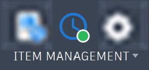

# Job Queue

**What you'll do here:** see whether a publish worked, and retry it if it did not.

Every publish is a **job**. The Job Queue shows the jobs that are waiting, running and finished, so you can see what the add-in is doing without keeping the Publish panel open.

**Quick steps:** open it with **Manage ▸ Item Management ▸ Administration ▸ Job Queue**. Click a job to see the reason for a failure. To send a failed job again, see [Retry a failed run](#retry-a-failed-run).

## How jobs run

Jobs go through a **single queue, one after another**. A publish returns at once, and the work happens in the background, so Fusion stays responsive and you can keep working, even in another design. A job that is waiting shows its place, for example *Waiting, number 2 in the queue*.

## Reading the queue

The panel is a table of every job that is waiting, running, failed or cancelled, newest first, **one row per job**. A job that went through leaves the list.

| Column | What it shows |
|---|---|
| **Status** | A pill with an icon and the status in words, the same width for every job |
| **Job** | The name of the job, the design it publishes |
| **Progress** | A sentence on where it stands, for example *Checking item numbers.*, *Publishing 4 of 5 items.*, *Updating the Bill of Materials, 12 of 40 requests.*, *Cancelled. Nothing was published.* or *Failed. 2 of 12 items failed.* |
| **Time** | How long the job has taken, counting up while it runs. A dash while it waits |
| | **Cancel** while it is waiting or running, **Retry** once it has failed |

{ width="1000" }

**Click a row for its details.** A window opens over the Job Queue with the result in words, the time it took, and a table of the job's items:

- **Filters** above the table show all items, or only the failed, skipped, cancelled, running, waiting or done ones, with how many there are of each. A job with failures opens on the failed items. **Find an item** narrows the table by item number or description.
- **Click an item** to see its details beside the table: its number, description, status and publish, and under them the reason in full when it failed, was skipped or was cancelled.
- **Retry** and **Cancel publish** are in the window too. Close it with **Close**, **Esc**, or by clicking outside it.

| Status | Meaning |
|---|---|
| **Queued** | Waiting for earlier jobs to finish |
| **Running** | Being prepared or sent |
| **Failed** | Failed, or finished with failed rows. The full reason is in the job's details |
| **Cancelled** | Stopped before it finished |

In a job's details, each BOM sent for a parent assembly also has its own line, after the items.

## Actions

- **Cancel** stops a job that is waiting or running. Items already processed are kept in the run's folder, and the rest are not published. The job stays listed as **Cancelled**, and the message at the top of the Job Queue says how many cancelled publishes are waiting to be cleared.
- **Clear finished** removes finished jobs from the list, and their files with them: a cleared job can no longer be retried. A job that finished with every row done removes itself.
- **Retry** appears on a job that failed or has failed rows. It sends the failed requests again. See [Request Files and Retry](#request-files-and-retry).

## Knowing when something ends

{ width="250" }

You do not have to watch the panel.

- The **Job Queue** button on the ribbon changes its icon. A **green dot** means a publish is waiting or running, a **red dot** means a listed job has failed, and the plain clock means nothing is running. The tooltip says which.
- When a job ends, a message box reports the result. A publish that completed shows **Total Items Processed**, **Total Items Created** and **Total Items Updated**. A failure lists the items that failed and why. This appears even if the Publish and Job Queue panels are closed.

## A failed job

A failed job stays in the Job Queue, marked **Failed**, until you clear it. **Click it to open its details**, which show what happened to every item in the job.

1. Open the [Job Queue](#reading-the-queue) and click the failed job. The details open on the **Failed** items.
2. Click an item in the table. Its **Reason** shows beside the table, in full.
3. Fix the cause in Fusion or Fusion Manage.
4. Click **Retry**, on the job's row or in its details. What Fusion Manage already accepted is skipped.

Choose **All** above the table to see the items that went through too. For common causes, see [Troubleshooting and Limitations](../reference/troubleshooting.md#publishing).

## Request Files and Retry

### What a run keeps

Every publish writes its files to a temporary folder (`MfgToFm` under the system temp folder) while it runs. The add-in removes only folders inside it, and nothing else.

- **A run that goes through** is removed when it ends, because everything was sent and there is nothing left to retry.
- **A run that fails, has failed rows or is cancelled** keeps its folder, so you can read it and use Retry.
- **Clear finished** removes those folders along with the jobs.

The path is listed in [Troubleshooting and Limitations](../reference/troubleshooting.md#where-files-are-kept). Each run has its own folder, containing:

| File | What it holds |
|---|---|
| Per-item request JSON | The exact request written for each item, a create or an update |
| Thumbnails | The images downloaded for the items |
| `bom/` | The BOM requests for each parent assembly |
| `manifest.json` | A summary of the run |
| `send-log.json` | A record of every request Fusion Manage accepted |

The files are what the retry below works from, and a record of what was sent for a run that did not go through.

### Retry a failed run

1. Open the [Job Queue](#job-queue).
2. Click **Retry** on the failed job.

The retry replaces the failed job in the list and sends the run's folder again, as a new job. It does not ask for confirmation, because it sends the same requests the run already wrote.

#### Nothing is sent twice

**What Fusion Manage already accepted is skipped.** The `send-log.json` in the folder records each accepted request, so sending a folder again carries on from where it stopped instead of creating items twice.

An item whose creation failed is not there for its BOM, so that BOM fails too. The other items carry on. After you fix the cause and click **Retry**, the item and then its BOM go through.

#### Folders it will not send

If the run's folder is missing or cannot be read (for example the run failed before it wrote its files), Retry says why in a message box. In that case, publish again.
