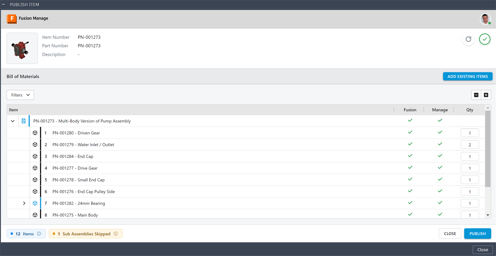
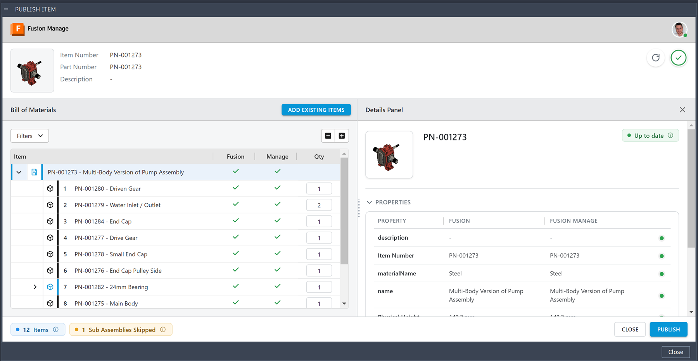
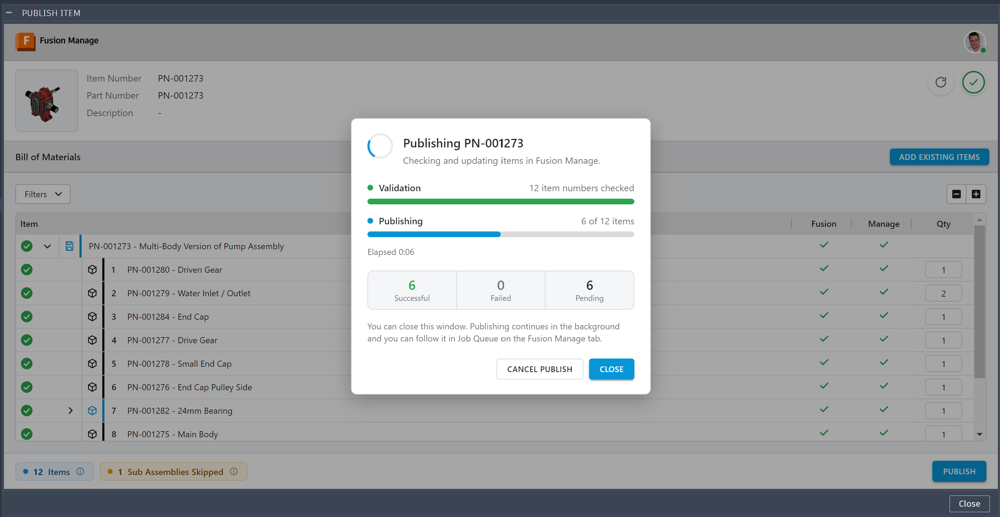
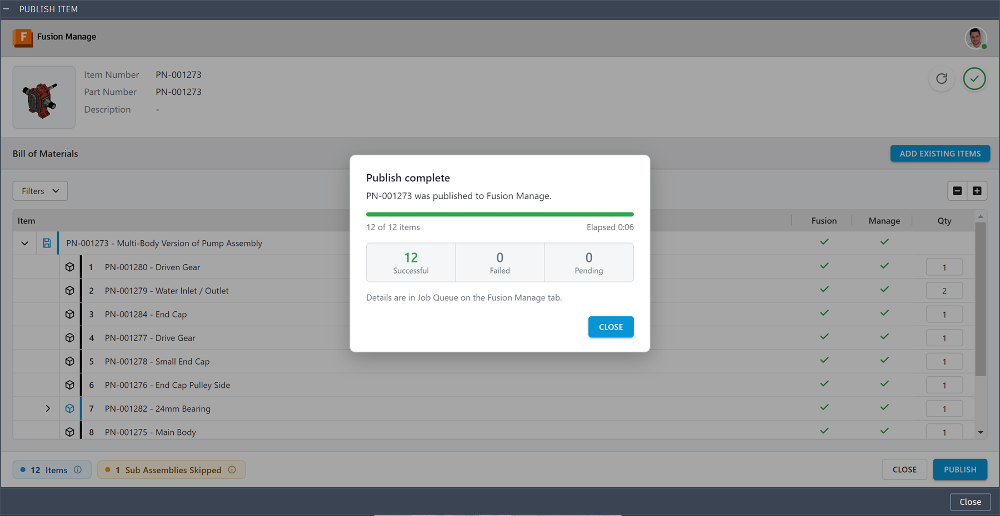
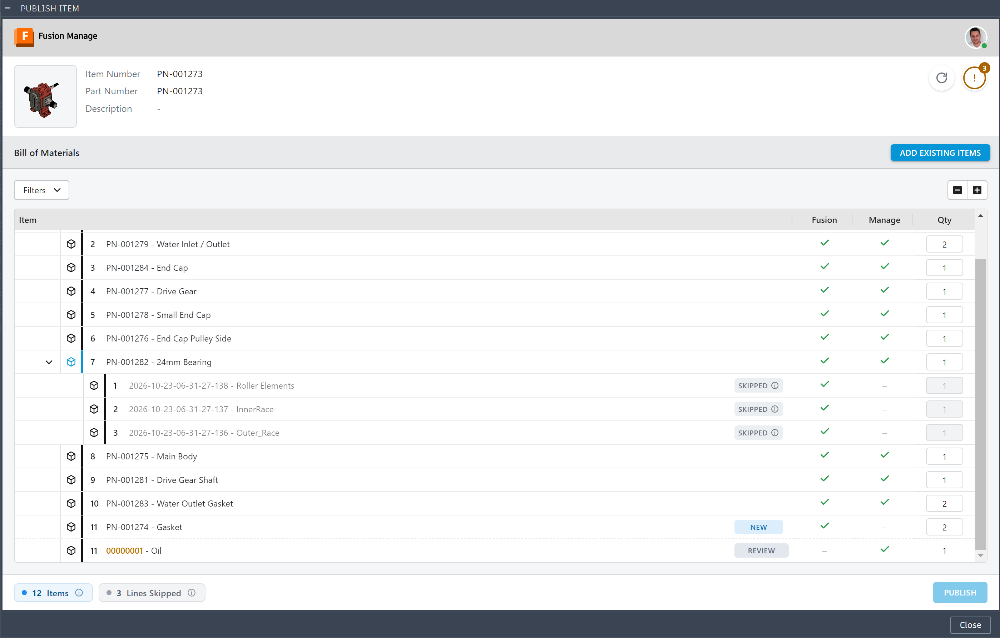
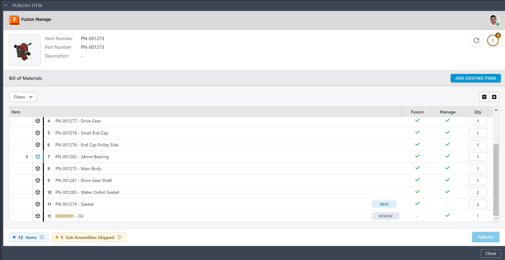
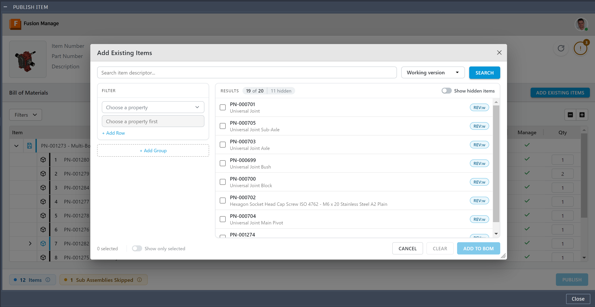
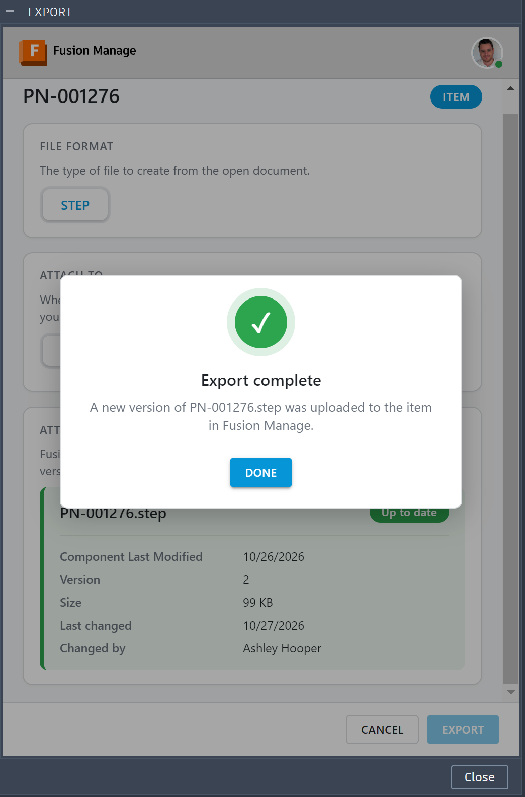
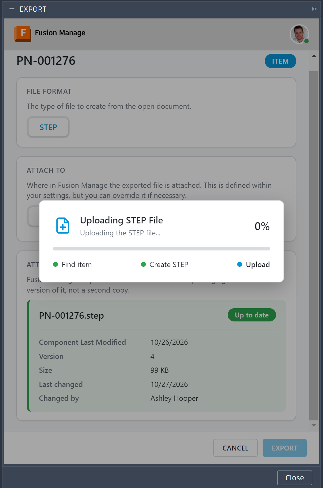
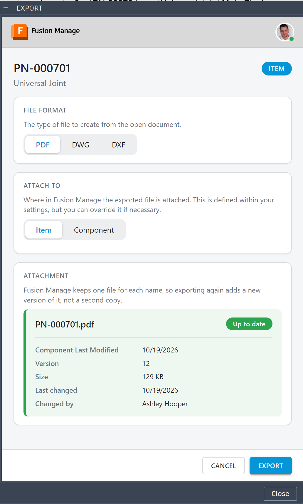

# Publishing

**What you'll do here:** turn a released design into manufacturing items in Fusion Manage, then attach STEP files and drawings.

Items and BOMs are sent by **Publish**. STEP files and drawing PDFs are different: they are **never sent by a publish** and are uploaded one at a time by you. See [Technical representations are manual](#technical-representations-are-manual).

## Quick steps

1. Open the saved design.
2. Right-click the top-level component and choose **Publish Fusion Manage Item**.
3. Check the BOM and the **New** or **Update** marks in the Details Panel.
4. Click **Publish**, and follow it in the [Job Queue](../job-queue/index.md).
5. Optional: attach a [STEP file](#step-file) or [drawing PDF](#drawing-representation).

Review the result in the [Item Panel](../item-panel/index.md).

## In this page

| Section | Read it when |
|---|---|
| [Open the Publish panel](#open-the-publish-panel) and [Publish](#publish) | You are publishing for the first time. |
| [Item Creation](#item-creation) and [Item Update](#item-update) | You want to know what is created, changed or never overwritten. |
| [Bill of Materials](#bill-of-materials) | You are comparing or editing the BOM. |
| [STEP File](#step-file) and [Drawing Representation](#drawing-representation) | You are attaching files. |

## Before you start

- You are signed in and the Items workspace is configured ([Installation and Authentication](../getting-started/installation.md), [Item Workspace](../configuration/index.md#item-workspace)).
- The design is saved and its components have item numbers. Items in Fusion Manage are matched by item number.
- Your Fusion Manage user holds the permissions listed in the Items workspace: View Items, Add Items, Edit Items, View BOM, Add To BOM and Edit BOM. Otherwise the panel shows a "no access" message naming what is missing.

## Open the Publish panel

Publishing always starts from the top of the design, so open the design first (a drawing cannot be published). There is no Publish button on the ribbon. Use either of these:

1. **From the design.** Right-click the top-level component in the browser and choose **Publish Fusion Manage Item**. The entry is offered on the top-level component only.
2. **From the Item panel.** Select the component and choose **Open Fusion Manage Item**, then do one of the following:
    - If the item is not in Fusion Manage yet, click **Publish to Fusion Manage**.
    - Open the **Actions** (**...**) menu and choose **Republish**. It is offered whenever a design is open.
    - If the tab's pill shows **Out of date**, click it to open the report, then click **Republish**.

    The Item panel closes as the Publish panel opens.

The panel shows the design's thumbnail and summary, and below it the **Bill of Materials** of the design compared with Fusion Manage. The thumbnail arrives a moment after the rest, so you can start on the BOM while it loads. Click a row to open the **Details Panel** beside it, which shows the item, a status pill at its top right, and a table of its properties with the value in Fusion, the value in Fusion Manage and a status dot for each. Hover a dot to see what publishing will do for that property. A row's details are read when you open it, and the design's own row reads its properties the first time you open it.

{ width="900" height="465" }

### Status in the Details Panel

The pill at the top right of the Details Panel shows what publishing will do for the component:

| Status | Meaning |
|---|---|
| **New** | No item exists in Fusion Manage yet; publishing creates it. See [Item Creation](#item-creation). |
| **Update** | The Fusion Manage value differs; publishing changes it. See [Item Update](#item-update). |
| **Up to date** | The mapped property values already match. A default value to send again, or a missing component link, is not shown here but is still sent with a publish. |
| **Shared number** | Several Fusion Manage items have this number. Fix it in Fusion Manage: publishing fails until then. |
| **Error** | Fusion Manage could not be read for this item. |

Properties with no mapping are listed as not published. Mapped properties are listed first so you see what will change.

{ width="900" height="466" }

## Publish

1. Review the BOM and details. **Refresh** reads the design and Fusion Manage again.
2. Optionally use **Add Existing Items** to include existing Fusion Manage items in the BOM (see [Bill of Materials](#add-existing-items)).
3. Click **Publish**. The button is enabled once the BOM has loaded. It stays disabled while a line still needs a choice (**Review**), while **Expand all** is reading the tree, and when the design's own item number is shared.

A progress dialog appears with up to three bars, one after the other, each with a percentage. **Reading** shows only when the Bill of Materials has levels that are not read yet: **Publish** reads and compares them first, counting the lines so far, and the bar turns green with the number of items found when it is done. **Validating** looks up every item number in Fusion Manage. If a number belongs to several items, or Fusion Manage cannot be searched, the run stops there and nothing is written (see [Item numbers that several items carry](#item-numbers-that-several-items-carry)). Once validation is complete and green, **Publishing** fills as the items are created or updated and then as the requests of the Bill of Materials are sent (each add, update, removal or renumber counts as one). You can close it; the run continues in the background and you can keep working in Fusion, even in another design. Closing it while **Reading** is still going drops the publish. Use **Cancel publish** to stop: items already processed are kept in the run's folder, the rest are not published.

Under the bars the dialog shows the time elapsed and a tally of **Successful**, **Failed** and **Pending** items. A **Skipped** box is added when items were left out on purpose.

{ width="900" height="465" }

### What a run does

1. Reads each item's properties from the Data Model and compares them with Fusion Manage (up to five items at once).
2. Downloads the thumbnail, for each item that is created or updated. It is attached only when a thumbnail is mapped to an image field; otherwise nothing is downloaded.
3. Writes a request file for each item, then sends it: a `POST` creates an item, a `PATCH` updates one.
4. Once **every** item exists, sends the BOM changes of each parent assembly. BOMs go last so that new parents and children already have IDs. Removals, updates and renumbers go first, up to five requests at a time; once they are all done, the adds follow, also up to five at a time. A line is therefore freed before another takes its position.

When the run ends, the progress dialog turns into the result. It reads **Publish complete** when every item went through, **Completed with errors** when some failed (see the [Job Queue](../job-queue/index.md) for the reasons), **Publish cancelled** after **Cancel publish**, **Validation failed** when the item numbers could not be checked or several items carry one (Publishing shows *Not started*), or **Publish failed** when the run could not finish after validation.

{ width="900" height="465" }

If you closed the dialog, Fusion shows a message box instead when the run completes or completes with errors (titled **Publish completed with errors**; nothing is shown for a cancelled run), with **Total Items Processed**, **Total Items Created** and **Total Items Updated**, and, for any failure, the item and the reason.

The run itself is shown in the [Job Queue](../job-queue/index.md), and if something fails you can send it again with [Request Files and Retry](../job-queue/index.md#request-files-and-retry).

## Technical representations are manual

A publish sends item data, the BOM and the thumbnail. It does **not** attach a STEP file or a drawing PDF. Those are uploaded manually, so you decide what goes to the supply chain, for which items, and when. See [STEP File](#step-file) and [Drawing Representation](#drawing-representation).

## What is and is not sent

- Mapped properties with no value in the Data Model are never sent. On a create the run records "No value in the Data Model, not sent" with the field names. On an update, a value Fusion Manage already holds is kept: Fusion having none never clears it. Only a real difference, such as Steel in Fusion and Plastic in Fusion Manage, is pushed.
- Properties are only ever added or changed. The add-in does not delete items, and removes a BOM line only when you choose **Remove** on it.
- A component whose item number is shared with another component is not published. See [Shared item numbers](#shared-item-numbers).

## Item Creation

When a component has no item in Fusion Manage yet, publishing **creates** one.

### When an item is created

For each component in the Publish panel, the add-in searches the Items workspace for an item with the component's **item number**. If nothing is found, the **Details Panel** shows **New** for it and a publish creates it. A design that is not in Fusion Manage at all has no status on its BOM lines, because there is nothing to compare them with. If an item is found, see [Item Update](#item-update).

The search is by item number only. Make sure your workspace maps **Item Number** to the Fusion Manage field that holds it (`NUMBER` in the default mapping). In Fusion Manage, that field must also be part of the Items workspace's item descriptor, or existing items are not found. See [The item number](../configuration/index.md#the-item-number).

### What a new item receives

A new item is created with:

| Content | Where it comes from |
|---|---|
| Every **mapped property** that has a value | The Manufacturing Data Model, through your [field mapping](../configuration/index.md#item-workspace) |
| Every **default value** | Your workspace settings. Default values are set on every new item |
| The **thumbnail** | The Data Model, when the thumbnail is mapped to an image field |
| The **component link** | The Fusion Manage component for the part, when a linking field is chosen |

How values are prepared:

- **Picklist fields** receive the matching option. A value that matches no option is left out and recorded, and the rest of the item is still created. See [Picklists](../configuration/index.md#picklists).
- **Number fields** are rounded to the precision the Fusion Manage field takes.
- **Empty values** are not sent. The run records *No value in the Data Model, not sent*, with the field names.

### Order of creation

Every component is created or updated first, **then** the BOM lines are sent. A BOM line needs both the parent and the child to exist, so BOMs always go last. See [Bill of Materials](#bill-of-materials).

If an item fails to be created, the other items carry on. The failed item's BOM is skipped, because the item is not there for it. You can retry from the [Job Queue](../job-queue/index.md#request-files-and-retry): what Fusion Manage already accepted is skipped, so nothing is created twice.

### Permission needed

Creating an item needs **Add Items** in the Items workspace.

### What does not happen

Creating an item does not attach a STEP file or a drawing PDF. Those are uploaded by you afterwards, only for the items you choose. See [STEP File](#step-file) and [Drawing Representation](#drawing-representation).

### After creation

The run reports **Total Items Created**. Open the new item in the [Item Panel](../item-panel/index.md) to check it.

## Item Update

When a component already has an item in Fusion Manage, publishing **updates** it, and only where something differs. Publishing the same design twice is safe.

### When an item is updated

The add-in searches the Items workspace for the component's item number.

| Result of the search | What happens |
|---|---|
| One item found | The item is compared with the design and updated where needed |
| No item found | The item is created. See [Item Creation](#item-creation) |
| Several items found | The status is **Shared number**. The run fails before it writes anything: fix the number in Fusion Manage (see [Item numbers that several items carry](#item-numbers-that-several-items-carry)) |

### What an update sends

An update sends only what has changed:

- **Mapped properties whose values differ.** These are the ones marked **Update** in the Details Panel.
- **Default values the item does not hold.** A default value is sent again when the item's field does not hold it, so a value someone changed in Fusion Manage is set back to the default. A field already holding the default is left alone.
- **The component link, if the item lacks it.**
- **The thumbnail.** Images cannot be compared, so the thumbnail is sent with every update, even when nothing else differs. An item with a mapped thumbnail is therefore updated by every publish.

If nothing differs and no thumbnail is mapped (or the component has none yet), **no request is sent** and the run records *Fusion Manage already has the same values*. Such an item is not counted as updated.

Numbers are compared at the precision of the Fusion Manage field. If the field already holds the number at its precision, it is not sent again.

### What is never overwritten

An update never changes:

- **A value Fusion Manage holds where Fusion has none.** Publishing never blanks a field.
- **Fields you have not mapped.** Anything entered in Fusion Manage that is not part of the mapping is untouched. This is how the manufacturing information added after publishing survives a later publish.
- **The item's lifecycle state and workflow.** Fusion Manage owns them.
- **BOM lines that only Fusion Manage has.** They are kept unless you choose to remove them. See [Bill of Materials](#bill-of-materials).

!!! tip "Engineering changes"
    When a design changes after it was published, publish again. Items that still match are skipped, items that differ are updated, and what Manufacturing added in Fusion Manage is preserved.

### Item numbers that several items carry

The add-in asks Fusion Manage for items whose descriptor matches the component's item number, and uses the item when exactly one comes back. When more than one comes back it does not guess, and nothing can be published until the number belongs to one item. This happens when two items in the workspace carry the same item number. Fusion Manage does not stop that, for example when items were created by hand or imported. The fix is in Fusion Manage: renumber or remove the extra items, then refresh the panel.

- **In the panel.** Open the component's details. The status is **Shared number**, and the Details Panel lists the Fusion Manage items that carry the number. A design whose own number is shared is not compared: the Bill of Materials says so, and **Publish** and **Add Existing Items** stay disabled.
- **When you publish.** Before anything is written, the run looks up every item number in Fusion Manage. If any number is carried by several items, the whole run fails and nothing is published. The progress dialog shows the Validating bar failed and Publishing not started. While the numbers are looked up, each row of the Bill of Materials shows a spinner, then a green tick, or a red cross when several items carry its number. The crosses stay after the failure, and the panel does not refresh, so you can find the items to fix. The run does not appear in the Job Queue. Nothing is partly published, so after you have fixed Fusion Manage you publish again.
- **If the look-up fails.** If Fusion Manage cannot be searched, the run fails the same way, because the numbers cannot be known to be unique.

The [Item Panel](../item-panel/index.md#when-several-items-share-the-number) asks which item you mean, and remembers the item you pick. The right-click STEP upload, the drawing upload and the Export window use the Item panel's choice; when several items match and none was chosen they stop with a message and attach nothing.

A BOM line of an assembly that matches several items is left without a status for the same reason. Fix it by removing the duplicate in Fusion Manage.

### Permission needed

Updating an item needs **Edit Items** in the Items workspace.

### After the update

The run reports **Total Items Updated**. Open the item in the [Item Panel](../item-panel/index.md) to check the result.

## Bill of Materials

The Publish panel compares the design's BOM with the BOM already in Fusion Manage, line by line, and sends only the differences. You decide how to handle anything that is in Fusion Manage but not in the design.

### Large designs

The panel reads the BOM one level at a time, so a large assembly opens quickly. At first it shows the design and the lines directly under it. Click an assembly's chevron to read the lines under it: a spinner replaces the chevron and grey rows hold the place until they arrive. If one assembly cannot be read, its rows show **Could not read this level** with a **Retry** button, and the rest of the table stays.

**Expand all** reads every level that is not read yet and opens everything; **Collapse all** closes every assembly except the design itself.

**Publish covers the whole design.** If some levels are not read yet, **Publish** first reads and compares every one of them (as **Expand all** does), then goes on to validate the item numbers and publish. If that read shows lines that need a choice (**Review**), they are opened for you and the publish waits; choose, then click **Publish** again. If the read fails, nothing is published. The pills at the bottom left count what is covered:

| Pill | Counts |
|---|---|
| **Items** | The design and every component of it: each is checked against Fusion Manage when you publish, and created or updated where it differs. |
| **Lines Skipped** | Lines with no item number (and what is below them): nothing is published for them. |
| **Shared Item Numbers** | Lines whose item number another component also carries (and what is below them): see [Shared item numbers](#shared-item-numbers). |

A line that needs a choice (**Review**) holds **Publish** back, whether its assembly is open or closed.

Each read is made a page of 250 lines at a time, and the panel shows how many lines it has read so far. The add-in never shows part of a BOM as if it were all of it. The filter counts and the check button cover only the levels read so far, and say so. If a read is bigger than the add-in can handle, the panel says so instead of showing a table when the first level fails, and shows a message and keeps the table when **Expand all** fails:

- More than **25,000 lines** in one read (a level, or the whole tree for **Expand all**).
- Nested **50 levels deep or more** (checked on the whole-tree read).
- A component that contains itself.

### How lines are compared

For each parent assembly, the lines of the design are matched to the Fusion Manage lines under that same parent by item number. Repeated item numbers pair one to one in order. Each line gets a status:

| Status | Meaning | Publishing does |
|---|---|---|
| **New** | The design has the line; Fusion Manage does not. | Adds the line. |
| **Update** | Same item, different quantity. | Updates the quantity in Fusion Manage. |
| *(no chip)* | Same item and quantity. | Nothing. |
| **Fusion Manage Only** | Fusion Manage has a line the design does not. It has no chip of its own; use the **Fusion Manage Only** filter to find it. | **Keeps it** unless you choose **Remove**. |
| **Review** | A **New** line and a **Fusion Manage Only** line sit under the same parent and need your choice (see [Paired rows](#paired-rows-a-replaced-item)). | Holds **Publish** back. |
| **Keep** / **Remove** | Your choice on a Fusion Manage Only line or a pair. | Keeps the line, or deletes it. |
| **Added** | You picked the item with [Add Existing Items](#add-existing-items). | Adds the line to the end of the Fusion Manage BOM. |
| **Skipped** | The component has no item number, shares one with another component, or sits below such a line. | Nothing: no item is created and no BOM line is added. |

If an assembly inside the design does not exist in Fusion Manage yet, every child of it is **New**. If the design itself is not in Fusion Manage, its lines show no status: the panel says publishing creates the design, and does not look up every component. When you publish, each component is searched for by item number, an item that exists is used, and one that does not is created.

Fusion Manage often extends the design BOM with manufacturing lines such as oil or panels. For that reason lines found only in Fusion Manage are never deleted automatically.

Each line reads **Item Number - Part Name**. A component with no item number is **Skipped**: no item can be created for it. Its quantity box is greyed out and cannot be edited, and the **i** on its chip explains why when you hover it. Everything below a skipped assembly is skipped too, because it has no item to join in the Fusion Manage BOM.

{ width="900" }

### Filters

The **Filters** drop-down above the table (top left) narrows it to rows of one status. Tick any number at once.

- **Statuses you can filter by:** **Review**, **New**, **Added**, **Update**, **Fusion Manage Only**, **Skipped** and **Duplicates**.
- **Counts and tooltips.** Each filter shows how many lines it holds, and its tooltip explains what it shows.
- **Show Hidden Components** is separate. It adds the components that are hidden in the Fusion component tree, marked with a crossed eye.
- **Clear filters** unticks them all.
- **Collapse all** and **Expand all**, next to it at the right, fold the whole tree.

#### Duplicates

**Duplicates** holds the lines whose item number several Fusion Manage items carry, so you can go straight to the items to fix.

- **When it fills.** Only when you click **Publish**. The Validating step looks up every item number in Fusion Manage, and any number that comes back with several items is added to the filter. Opening the panel or a component's details does not fill it.
- **What you see.** The lines appear under the filter, and the same red crosses show on their rows.
- **How long it lasts.** Until you refresh the panel, or the next publish checks the numbers again.
- **What to do.** Renumber or remove the extra items in Fusion Manage, then publish again.

### Paired rows: a replaced item

When a **New** design line and a **Fusion Manage Only** line sit under the same parent **at the same position in the BOM**, they are shown **paired**, one above the other, each carrying the other's item number. The item number differs at that position, which may mean an item was replaced, so the add-in asks you to decide rather than guessing.

Lines at different positions are not paired. For example, if line 11 was removed in Fusion Manage and a line 12 (oil) was added there, the design's line 11 is simply **New** and the oil line is **Fusion Manage Only**, kept unless you choose **Remove**. Nothing needs a choice.

{ width="900" }

For a pair you can choose:

- **Keep** the Fusion Manage line, which is renumbered to the end of the BOM, and add the new design line.
- **Remove** the Fusion Manage line from Fusion Manage and add the design's line.

A Fusion Manage Only line with no partner shows a single **Remove** button; click it again to go back to keeping the line. A line marked for removal is highlighted so you cannot miss it.

### Editing quantities

A quantity can be edited in the table. An edited cell shows a revert button that restores the original value.

### Add Existing Items

**Add Existing Items** (top right of the BOM) opens a picker that searches the Items workspace so you can add items that are not in the design.

{ width="900" }

- With nothing typed the picker lists every item of the workspace; **Search** applies the search box and the filters.
- The search box matches the item descriptor. The **Filter** pane on the left narrows the results by property: choose a property and a value (a drop-down for properties with a fixed list). **Add Row** adds another property to the group and **Add Group** starts a new group. Rows of a group, and groups, are joined by **AND** or **OR**; the Items workspace is always applied on top.
- Results load 50 at a time as you scroll. Tick the items to add; selections survive searching and paging, and **Clear** unticks them all.
- The bar under the list shows how many items are selected. **Show only selected** narrows the list to the ticked items, so you can review them before adding. **Cancel** closes the picker without adding anything.
- Items the Bill of Materials already holds, or that you have already added in the panel, are hidden. Turn on **Show hidden items** to see them ticked, greyed out and locked.
- Next to **Search** a version picker chooses the latest or the working version of the items. **Add to BOM** in the footer adds the ticked items; **Show only selected** is disabled until something is ticked.
- Added lines appear in the BOM as **Added** and can be taken out again with their own **Remove** button before publishing.

### What gets sent

Each change becomes one request against the parent item's BOM:

| Operation | Request |
|---|---|
| Add a line | `POST` to the parent's `bom-items` |
| Change a quantity | `PATCH` with the new quantity |
| Renumber a kept line | `PATCH` with the new BOM item number |
| Remove a line | `DELETE` |

They are ordered so a line is freed before another takes its number: remove, renumber, update, add.

All BOM requests are sent **after** every item exists, one parent at a time. A failure stops only that parent; the others carry on. Adding a line the BOM already has is reported by Fusion Manage as a duplicate; the add-in logs it and treats it as done, so no failure is recorded. See [Request Files and Retry](../job-queue/index.md#request-files-and-retry) for sending it again.

## The Export Window

**Export** (in the **Export** panel of the **Manage** tab) opens one small window for every file the add-in can attach. You choose two things:

1. **Attach to.** Two cards, at the top. **Item** attaches the file to the item of the part in the Items workspace. **Component** attaches it to the part's record in the Components workspace: its **working version**, when the part has several revisions. When the window opens it checks, in Fusion Manage, that you may attach files to each workspace (**View Items**, **Add Attachments** and **Edit Attachments**; the last is for a new version of a file already there). A card you may not use is greyed out and says why. If the Items workspace is not set up in Preferences, **Item** says *Item is not configured. Complete it in Preferences.* and a usable card is chosen for you: the default for that format in **Preferences ▸ Export** if it can be used, otherwise the first usable one. **Component** is also greyed out when the connection is invalid or there is no Components workspace.
2. **File format.** What the open document can be exported as: a **design** makes a **STEP** file; a **drawing** makes a **PDF**, **DWG** or **DXF**. The window names what is being exported: the selected component of a design (else the whole design), or the top of a drawing.

The window starts with what is being exported: its item number (a grey bar stands there while it is read from Fusion Manage), and under it the description of the design. The attachment card shows whether the file already in Fusion Manage is **Up to date**, with the date the component was last modified, the file's version, size and who changed it.

Choose **Export** and the window stays open and shows the progress: **Find item**, the file being made, and **Upload**, with a percentage where one can be measured. It then says how it went. On success it reads *Export complete* with where the file went, and **Done** closes it. On a failure it reads *Export failed* with the reason; **Try again** takes you back to the choices, and **Close** closes the window. **Cancel** closes the window before an export starts. The file is named after the item number and a file of the same name is replaced by a new version. See [STEP File](#step-file) and [Drawing Representation](#drawing-representation).

The **Actions** menu of the [Item Panel](../item-panel/index.md) and the right-click entries do not open this window: they export in one step and always attach to the item.

## STEP File

The add-in can attach a **STEP file** of a component to its Fusion Manage item, so the wider supply chain has a neutral 3D representation to work from.

!!! important "Uploaded by you, never automatic"
    Publishing an item does not attach a STEP file. STEP files are uploaded manually, one component at a time, so you stay in control of what is released, for which items, and when. If you never upload one, none is sent.

The item must already exist. Publish it first ([Item Creation](#item-creation)).

### Find the right-click entry

**Export STEP File** is in the right-click menu of a component. It is the quickest way to upload, with no window to fill in.

1. Open the saved design in the Design workspace. The entry is not offered in a drawing.
2. Right-click the component you want, in the browser or on the canvas. Any component works, not only the top one. With nothing selected, the design's top-level component is used.
3. Choose **Export STEP File**.

The entry appears only once the add-in is set up. The upload then runs as described below: the item is found by its item number, a STEP file of the selected component is made and attached to that item, and a file already attached with the same name becomes a new version. See [New versions, not duplicates](#new-versions-not-duplicates).

You can also click **Export** in the **Export** panel of the **Manage** tab on the ribbon. This opens the [Export window](#the-export-window), where you choose whether to attach to the item or the component, and the file format (STEP for a design). The upload is also in the **Actions** menu of the [Item Panel](../item-panel/index.md). The right-click entry and the Actions menu always attach to the item. Only the Export window lets you attach to the component record instead.

### Upload a STEP file

The file is named after the item number, for example `PN-1001.step`.

1. In the Design workspace, select a component in the browser or canvas. With nothing selected, the open design's top-level component is used.
2. Do one of the following:
    - Right-click and choose **Export STEP File** (offered on any component, not only the top).
    - Open the item in the [Item Panel](../item-panel/index.md) and choose **Actions ▸ Export STEP File**.
3. A small **Uploading STEP File** window shows three stages: **Find item**, **Create STEP** and **Upload**, with a percentage where one can be measured.
4. When it finishes you see a confirmation: `<name> was attached to the item in Fusion Manage.` or `A new version of <name> was uploaded to the item in Fusion Manage.` It appears as a message box, or as a toast when the Item panel is open.

#### New versions, not duplicates

If a file of the same name is already attached, the upload creates **a new version** of it instead of a duplicate, and the confirmation says so. You can refresh a STEP file as the design changes without cluttering the item.

{ width="450" }

### Which geometry is exported

The STEP file contains the **selected component**, not the whole design.

- If the selected component is the design's **top-level component**, the whole design is exported.
- Otherwise the add-in finds the component in the open design by its **part number** (the one you selected is tried first) and exports just that.
- If Fusion cannot export it directly from the open design, the add-in falls back to the component's own document.

The part number only locates the component in Fusion. The item it is attached to is found by the component's **item number**, read from the Data Model. Finding a component by part number can take a while in large designs. The progress window stays responsive and you will see the percentage move.

{ width="450" }

### Messages you may see

- **Open the design to publish as a STEP file first.** No design is open.
- **Select a component that has a part number, or open a design that has one.** The selected component has no part number.
- **No component with part number … in the open design.** The selected component's part number is not found in the open design.
- **… has no item number, so it has not been published to Fusion Manage.** and **The design has not been saved, so it has no item number.** The item number cannot be read.
- **No item exists for …** No item in Fusion Manage has that item number. Publish the item first.
- **… Fusion Manage items match … Open the item in the Item panel and choose one first.** Several items share the item number. Open the item from the Item panel, pick one from the list, and try again.
- **Fusion could not export the STEP file.** Fusion refused the export; the message lists each method that was tried (open design, component, own document).

Messages after the item search start with *Could not attach a STEP file:* or *Could not create PN.step:*.

Only one upload runs at a time. Starting another reports that a file is already being uploaded.

### Seeing the result

The file appears on the **Files** tab of the item in the [Item Panel](../item-panel/index.md#files). If the panel is open it shows a success toast and re-reads the item, so the file count updates.

## Drawing Representation

The add-in can attach a **PDF of a drawing** to the Fusion Manage item of the design the drawing shows, so the supply chain has the released drawing alongside the item.

!!! important "Uploaded by you, never automatic"
    Publishing an item does not attach a drawing PDF. Drawing PDFs are uploaded manually, so you decide which drawings go to the supply chain, and when.

A drawing is **not an item of its own**. Its PDF is attached to the item of the design's top-level component. That item must already exist; publish it first ([Item Creation](#item-creation)).

{ width="450" }

### Upload a drawing PDF

1. Open the drawing. The add-in works out which item it belongs to from the design the drawing references: the part number of that design's **top-level component** is read, then its item number from the Data Model, and the item with that number is the one used.
2. Choose **Manage ▸ Export ▸ Export** and pick PDF, or right-click the top of the drawing's component tree and choose **Export PDF**. In a drawing, the [Item Panel](../item-panel/index.md) **Actions** menu offers the same upload.
3. A PDF of every sheet of the drawing is created, named after the item number (for example `PN-1001.pdf`), and uploaded in a window with the stages **Find item**, **Create PDF** and **Upload**.

The Export window and the Item Panel's **Actions** menu can also make a **DWG** or a **DXF** of the drawing, attached the same way, as `PN-1001.dwg` or `PN-1001.dxf`. The right-click entry makes the PDF only. A Fusion that cannot export those formats says so.

The right-click entry is meant for the top of the tree. It is not offered on an occurrence or on a component other than the design's top-level one, but it can appear for other kinds of selection.

#### New versions, not duplicates

If a file of the same name is already attached, the upload creates **a new version** of it instead of a duplicate.

### The drawing must be loaded

A drawing takes a moment to load. Until its design reference has loaded and the top-level component's part number can be read, the right-click entry is greyed out and its tooltip says what it is waiting for (*Not available:* followed by a reason such as *The drawing has no references yet.* or *The top-level component of … has no part number.*). The add-in checks again when Fusion reports a document or workspace change, or after 15 seconds without one, and gives up after 60 seconds. In the Item panel's **Actions** menu the entry is disabled with *The drawing is still loading* and updates when you open the menu or return to the window. The Export window shows *The drawing is not ready yet* and asks again every 2 seconds.

### If the PDF is empty

Fusion can report an export as successful straight after a drawing opens while writing nothing. The add-in detects this and asks you to wait for the drawing to finish loading and try again.

### Seeing the result

The PDF appears on the **Files** tab of the item in the [Item Panel](../item-panel/index.md#files). If the panel is open it shows a success toast and re-reads the item, so the file count updates.
